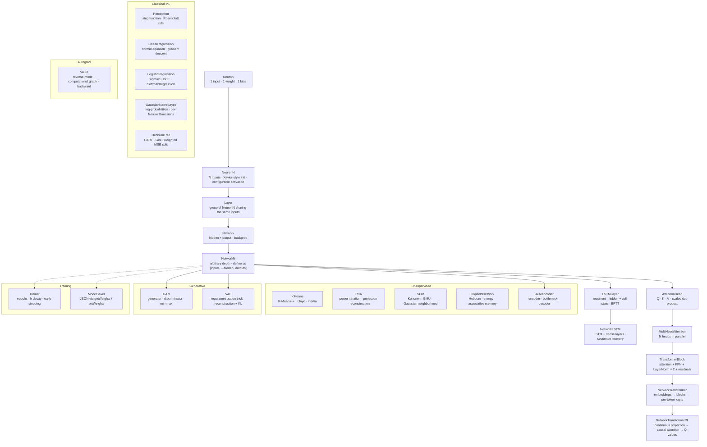

[](https://www.npmjs.com/package/@dniskav/neuron)
[](LICENSE)

A minimal, dependency-free neural network library built from scratch in TypeScript. Designed for learning and experimentation — every line of math is readable.

Each class is a building block for the next: from a single neuron to a full Transformer with causal attention. Includes classical ML, unsupervised learning, generative models, embeddings, convolutional and recurrent layers, and autograd — all in pure TypeScript, zero dependencies.



## What's inside

### Neural network building blocks

| Export | Description |
|--------|-------------|
| `Neuron` | Single-input neuron. The simplest possible unit: one weight, one bias. |
| `NeuronN` | N-input neuron with Xavier-style initialization (weights in ±√(1/n)) and a configurable activation. |
| `Layer` | A group of `NeuronN` neurons that share the same inputs. |
| `Network` | Two-layer network (one hidden layer + output) with backpropagation. |
| `NetworkN` | Deep network of arbitrary depth. Define your architecture as `[inputs, ...hidden, outputs]`. |
| `LSTMLayer` | Recurrent layer with persistent hidden and cell state. Learns sequences via BPTT. |
| `NetworkLSTM` | An `LSTMLayer` followed by dense layers. Keeps memory across steps within an episode. |
| `GRULayer` | Gated recurrent unit with reset and update gates and no separate cell state. |
| `NetworkTransformer` | Token-classification Transformer: embeddings → N blocks → per-token logits. |
| `NetworkTransformerRL` | Transformer for RL agents: continuous input projection → causal blocks → Q-values. |
| `TransformerBlock` | One Transformer block: multi-head attention + FFN + two LayerNorms with residual connections. |
| `MultiHeadAttention` | N attention heads in parallel, concatenated and projected back to `d_model`. |
| `AttentionHead` | One scaled dot-product self-attention head (Q / K / V projections + backprop). |

### Layers & components

| Export | Description |
|--------|-------------|
| `Conv1D` | 1D convolution over sequences. Multi-channel input, configurable stride and padding (`'valid'` or `'same'`). |
| `Conv2D` | 2D convolution for images. Kernels `[filters][kH][kW][channels]`, with forward and backward pass. |
| `MaxPool2D` | 2D max pooling. Stores the argmax of each window, so the gradient goes only to that position. |
| `Flatten` | Converts `[H][W][C]` tensors to flat vectors. Bridges convolutional layers to dense layers. |
| `RNN` | Vanilla recurrent network with BPTT. Its comments show where gradients vanish or explode. |
| `Seq2Seq` | Encoder and decoder built on `LSTMLayer`, with the encoder's final state passed to the decoder. Teacher forcing in training. |
| `CausalConv1D` | Causal dilated 1D convolution (left padding, no look-ahead). One building block of a TCN. |
| `TCN` | Temporal Convolutional Network. Stacks causal dilated convolutions for sequences without recurrence. |
| `LayerNorm` | Layer normalization with learnable γ and β per feature. |
| `BatchNorm` | Batch normalization with running mean and variance, used for inference. |
| `Dropout` | Inverted dropout for regularization. Active only during training. |
| `WeightMatrix` | 2D weight matrix with per-element Adam state and optional gradient clipping (`update(dW, lr, clipValue?)`). |
| `BiasVector` | 1D bias vector with per-element Adam state. |
| `EmbeddingMatrix` | Lookup-table embedding with SGD updates on the rows that were used. |

### Classical ML

| Export | Description |
|--------|-------------|
| `Perceptron` | The historical Rosenblatt perceptron (1957). Step function, linear rule. Shows why XOR cannot be learned. |
| `LinearRegression` | Closed-form normal equation (`fitNormal`) or gradient descent (`fitGD`). Pure array arithmetic. |
| `LogisticRegression` | Sigmoid + binary cross-entropy, no hidden layers. The boundary between classical ML and neural nets. |
| `SoftmaxRegression` | Multinomial logistic regression with a max-subtracted softmax for numerical stability. |
| `GaussianNaiveBayes` | Class scores in log-space from per-feature Gaussian likelihoods. Fitted by statistics, no gradient descent. |
| `DecisionTree` | CART: Gini impurity for classification, weighted MSE for regression. Depth limited by `maxDepth`. |

### Unsupervised learning

| Export | Description |
|--------|-------------|
| `KMeans` | K-Means++ initialization + Lloyd's algorithm. `inertia()` helps choose K with the elbow method. |
| `PCA` | Principal Component Analysis via power iteration + Hotelling deflation. `transform`, `inverseTransform` (approximate) and `explainedVarianceRatio`. |
| `SOM` | Self-Organizing Map (Kohonen). BMU search and Gaussian neighborhood update. |
| `HopfieldNetwork` | Associative memory. Hebbian storage, energy function, asynchronous recall. Capacity ≈ 0.138·N patterns. |
| `Autoencoder` | Encoder, bottleneck and decoder built from two `NetworkN` instances. Learns compressed representations. |

### Generative models

| Export | Description |
|--------|-------------|
| `GAN` | Generator vs discriminator min-max game, trained step by step (`trainStep`). |
| `VAE` | Variational Autoencoder. Reparametrization trick; loss = reconstruction + `klWeight` · KL divergence (`klWeight` defaults to 1). |

### Automatic differentiation

| Export | Description |
|--------|-------------|
| `Value` | Scalar autograd node. Builds a computational graph and propagates gradients with `.backward()`. Same principle as micrograd. |

### Embeddings

| Export | Description |
|--------|-------------|
| `Word2Vec` | Word embeddings via Skip-gram or CBOW, with a full-vocabulary softmax. Cosine `similarity`, `mostSimilar`, and `analogy`. |
| `TSNE` | t-SNE dimensionality reduction. Per-point perplexity binary search, Student-t kernel, KL gradient, early exaggeration. |
| `PositionalEncoding` | Sinusoidal positional encoding (Vaswani et al.). No parameters; `dModel` may be odd. |
| `LearnedPositionalEncoding` | Trainable positional table of `maxSeqLen × dModel`, with a small Xavier-like random initialization. |
| `ContrastiveLearning` | SimCLR-style self-supervised learning. Encoder + projection head, NT-Xent loss, temperature. |
| `Augmenter` | Views for contrastive pairs: Gaussian noise, feature dropout (no rescaling of kept values), `makePair()`. |

### Activations & math

| Export | Description |
|--------|-------------|
| `sigmoid` `relu` `tanh` `linear` `leakyRelu` `elu` | Built-in activations, each with `fn(x)` and `dfn(out)` (derivative computed from the output). |
| `makeLeakyRelu(α)` `makeElu(α)` | Factories for leaky ReLU and ELU with a custom slope α. |
| `matMul` `transpose` `softmax` `softmaxBackward` | Matrix and softmax helpers. `softmaxBackward` is the softmax gradient. |

### Optimizers

| Export | Description |
|--------|-------------|
| `SGD` | Vanilla stochastic gradient descent. Stateless. |
| `Momentum` | Accumulates a velocity vector in the gradient direction. |
| `Adam` | Adaptive moment estimation. Per-parameter first and second moments with bias correction. |
| `ClipOptimizer` | Wraps any optimizer and clips each gradient to `[-clipValue, +clipValue]` before the step. |
| `ClippedOptimizerFactory` | `(innerFactory, clipValue)`: builds clipped optimizers from any optimizer factory. |
| `defaultOptimizer` | Default factory (`() => new SGD()`), used when no optimizer is given. |

### Loss functions

| Export | Description |
|--------|-------------|
| `mse` `crossEntropy` | Scalar loss functions for evaluation and logging. |
| `mseDelta` `crossEntropyDelta` `crossEntropyDeltaRaw` | Output-layer delta functions to pass to `trainWithDeltas`. |

### Metrics & evaluation

| Export | Description |
|--------|-------------|
| `confusionMatrix` | Confusion matrix as `number[][]`. |
| `accuracy` | Fraction of correct predictions. |
| `precision` `recall` `f1Score` | Classification metrics. For multiclass problems they are macro averages (the mean of the per-class values). |
| `rocCurve` `auc` | ROC curve points and area under the curve (trapezoidal rule). |
| `mae` `rmse` `r2Score` | Regression metrics. |
| `perplexity` | `exp(mean cross-entropy)` from predicted probabilities. A common metric for language models. |
| `printConfusionMatrix` `classificationReport` | Console-formatted tables: the confusion matrix, and a per-class report with macro averages. |

### Training utilities

| Export | Description |
|--------|-------------|
| `Trainer` | Training loop with epochs, learning-rate decay, L2 weight decay, optional early stopping and classification metrics. Validation data is used only with `earlyStopping`. |
| `EarlyStopping` | Stops training when a monitored value stops improving. Options: `patience`, `minDelta`, `mode` and `restoreBest`. |
| `LRScheduler` | Learning-rate schedules: `stepDecay`, `exponentialDecay`, `plateauDecay` and `cosineAnnealing`. |
| `DataLoader` | Wraps `{ inputs, targets }` data with batching, shuffling and a validation split. `DataLoader.sequences` builds windows over a time series. |
| `DataAugmentation` | Noise, jitter, horizontal flip, normalization, z-score, batch augmentation, shuffle, and a 70/15/15 train/validation/test split. |
| `WeightInspector` | Per-layer weight statistics (mean, std, dead weights) and dead-ReLU counts. |
| `LossPlotter` | Renders a loss curve as ASCII art in the terminal. |
| `ModelSaver` | Serialization through the flat `getWeights()` / `setWeights()` interface. JSON with `format: 1`, plus `saveToFile` / `loadFromFile` helpers that take a file function. |

### Tokenizer & datasets

| Export | Description |
|--------|-------------|
| `Tokenizer` | Vocabulary builder with `char`, `word` or `whitespace` modes. `encode`, `encodeBatch`, `decode`, `oneHot`, and JSON snapshots. |
| `DatasetLoader` | Loads CSV (`fromCSV`) or JSON (`fromJSON`) data, one-hot encoding string columns and returning the category maps. |

### Validation helpers

| Export | Description |
|--------|-------------|
| `validateArray(arr, length, method)` | Throws unless `arr` is an array of exactly `length` finite numbers. |
| `validateArrayMinLength(arr, minLength, method)` | Throws unless `arr` is an array with at least `minLength` elements. |
| `validate2DArray(arr, rows, cols, method)` | Throws unless `arr` is a `rows × cols` matrix of finite numbers. |
| `validateNumber(value, method)` | Throws unless `value` is a finite number. |

### Types

| Export | Description |
|--------|-------------|
| `Activation` | Interface of an activation function: `fn(x)` and `dfn(out)`. |
| `Optimizer` | Interface implemented by `SGD`, `Momentum`, `Adam` and `ClipOptimizer`. |
| `OptimizerFactory` | `() => Optimizer`. A network creates one optimizer per weight. |
| `NetworkNOptions` | Options for `NetworkN` (activations per layer, optimizer factory, residual connections). |
| `NetworkLSTMOptions` | Options for `NetworkLSTM`. |
| `NetworkTransformerOptions` | Options for `NetworkTransformer`. |
| `NetworkTransformerRLOptions` | Options for `NetworkTransformerRL`. |
| `TransformerBlockOptions` | Options for `TransformerBlock`. |
| `TrainerOptions` | Options for `Trainer`: `epochs`, `lr`, `lrDecay`, `weightDecay`, `earlyStopping`, `restoreBestWeights`, `computeMetrics`, `verbose`. |
| `TrainDataset` | `{ inputs, targets }` arrays given to `Trainer.train`. |
| `TrainableNetwork` | Any object with `train(inputs, targets, lr)` that returns a loss. |
| `TrainableNetworkWithWeights` | `TrainableNetwork` that also has `predict`, `getWeights` and `setWeights` (needed for early stopping with restored weights). |
| `TrainMetrics` | Per-epoch classification metrics: accuracy, and macro precision, recall and F1. |
| `DataPair` | `{ inputs, targets }` pair used by `DataLoader` and `Trainer.setValidationData`. |
| `DatasetLoaderOptions` | Options for `DatasetLoader`: `featureCols`, `targetCols`, `encodeStrings`. |
| `DatasetLoaderResult` | Result of `DatasetLoader`: the data plus the feature and target names and the category maps. |
| `CategoricalMap` | Maps each one-hot encoded column to its `{ category → index }` dictionary. |
| `Serializable` | Interface for `ModelSaver`: `getWeights()` and `setWeights(weights)`. |
| `KMeansOptions` | Options for `KMeans`: `maxIter` and `seed`. |
| `SOMOptions` | Options for `SOM`: `initialLr`, `finalLr`, `initialSigma`, `finalSigma`. |
| `Word2VecOptions` | Options for `Word2Vec`: `windowSize`, `model`, `minCount`. |
| `Word2VecModel` | `'skipgram' \| 'cbow'`. |
| `TSNEOptions` | Options for `TSNE`, among them `nComponents`, `perplexity` and `lr`. |
| `WeightStats` | Statistics for one layer, as returned by `WeightInspector`. |
| `TokenizerMode` | `'char' \| 'word' \| 'whitespace'`. |
| `TokenizerOptions` | Options for `Tokenizer` (mode, `lowercase`, `maxVocab`, special tokens). |
| `EncodeOptions` | `addBOS` and `addEOS` for `Tokenizer.encode`. |
| `EncodeBatchOptions` | `EncodeOptions` for `Tokenizer.encodeBatch`, plus `padTo` (pad or truncate every sequence to one length). |
| `TokenizerSnapshot` | JSON snapshot of a `Tokenizer` (from `toJSON`, read by `fromJSON`). |

## Install

```bash
npm install @dniskav/neuron
```

Requires Node.js 20 or later (`engines` in `package.json`). The package ships CommonJS and ES module builds, with TypeScript declarations.
## Usage

Each example is self-contained: it imports from `@dniskav/neuron`, defines its own data and runs in a few seconds, with no network and no files. Examples that use randomness fix it, so the printed values are reproducible: most replace `Math.random` with a small seeded generator, and `KMeans` takes a `seed` option. Each example ends with a check that throws if the result is not the expected one.

### Single neuron — learn a threshold

```ts
import { Neuron } from "@dniskav/neuron";

// Seeded generator (Park-Miller) so the initial weights are reproducible.
let seed = 42;
Math.random = () => (seed = (seed * 16807) % 2147483647) / 2147483647;

// Minors (10 to 16) are labelled 0 and adults (20 to 30) are labelled 1.
const data: [number, number][] = [[10, 0], [30, 1], [12, 0], [28, 1], [14, 0], [25, 1], [16, 0], [20, 1]];
const neuron = new Neuron();

for (let epoch = 0; epoch < 1000; epoch++) {
  for (const [age, label] of data) neuron.train(age, label, 0.1);
}

const minor = neuron.predict(10);
const adult = neuron.predict(30);
console.log(minor.toFixed(3), adult.toFixed(3)); // 0.094 1.000
if (!(minor < 0.2 && adult > 0.8)) throw new Error(`unexpected output: ${minor}, ${adult}`);
```

### NetworkN — deep network with custom architecture

`NetworkN` takes the layer sizes, one activation per layer and an optimizer factory. This example learns XOR, which a single neuron cannot represent, with one ReLU hidden layer and a sigmoid output trained with Adam.

`train` returns the mean squared error of the example. The step it applies is the gradient of that mean error: with one output, the error term is `2 × (target − prediction)`, multiplied by the activation derivative and by the learning rate.

```ts
import { NetworkN, relu, sigmoid, Adam } from "@dniskav/neuron";

// Seeded generator (Park-Miller) so the initial weights are reproducible.
let seed = 7;
Math.random = () => (seed = (seed * 16807) % 2147483647) / 2147483647;

const inputs  = [[0, 0], [0, 1], [1, 0], [1, 1]];
const targets = [[0], [1], [1], [0]];

const net = new NetworkN([2, 8, 1], {
  activations: [relu, sigmoid],
  optimizer: () => new Adam(),
});

let meanLoss = 0;
for (let epoch = 0; epoch < 2000; epoch++) {
  let sum = 0;
  for (let i = 0; i < inputs.length; i++) {
    sum += net.train(inputs[i], targets[i], 0.01);
  }
  meanLoss = sum / inputs.length;
}

const predictions = inputs.map((x) => net.predict(x)[0]);
console.log(predictions.map((p) => p.toFixed(2)), meanLoss.toFixed(4)); // [ '0.00', '1.00', '1.00', '0.00' ] 0.0000
const correct = predictions.every((p, i) => (targets[i][0] === 1 ? p > 0.5 : p < 0.5));
if (!correct || meanLoss > 0.05) throw new Error(`XOR not learned: ${predictions}, loss ${meanLoss}`);
```

### Historical Perceptron — step function, no hidden layers

```ts
import { Perceptron } from "@dniskav/neuron";

const p = new Perceptron(2);

// Learns AND gate (linearly separable). Each row is [a, b, target].
const data: [number, number, 0 | 1][] = [[0, 0, 0], [0, 1, 0], [1, 0, 0], [1, 1, 1]];
for (let e = 0; e < 100; e++)
  for (const [a, b, t] of data) p.train([a, b], t, 0.1);

const and11 = p.predict([1, 1]);
const and01 = p.predict([0, 1]);
console.log(and11, and01); // 1 0
if (and11 !== 1 || and01 !== 0) throw new Error(`AND not learned: ${and11}, ${and01}`);
// XOR cannot be learned: it is not linearly separable.
```

### Linear Regression — normal equation

```ts
import { LinearRegression } from "@dniskav/neuron";

const model = new LinearRegression();

// Exact closed-form solution in one call
model.fitNormal(
  [[1], [2], [3], [4]],  // X
  [2, 4, 6, 8]           // y = 2x
);

const y5 = model.predict([5]);
const { weights, bias } = model.getCoefficients();
console.log(y5, weights, bias); // ~10, [~2], ~0
if (Math.abs(y5 - 10) > 1e-9 || Math.abs(weights[0] - 2) > 1e-9 || Math.abs(bias) > 1e-9)
  throw new Error(`unexpected fit: ${y5}, ${weights}, ${bias}`);
```

### Logistic Regression — sigmoid + BCE

`train` runs online SGD for the given number of epochs and returns the mean binary cross-entropy of each epoch. Labels must be numbers in [0, 1].

```ts
import { LogisticRegression } from "@dniskav/neuron";

// Seeded generator (Park-Miller) so the initial weights are reproducible.
let seed = 11;
Math.random = () => (seed = (seed * 16807) % 2147483647) / 2147483647;

const clf = new LogisticRegression();
const lossHistory = clf.train(
  [[0, 0], [1, 1], [1, 0], [0, 1]],
  [0, 1, 1, 0],
  0.1, 500
);

const first = lossHistory[0];
const last = lossHistory[lossHistory.length - 1];
const high = clf.classify([0.9, 0.9]);
const low = clf.classify([0.1, 0.1]);
console.log(first.toFixed(3), last.toFixed(3), high, low); // 1.022 0.027 1 0
if (!(last < first && high === 1 && low === 0)) throw new Error("logistic regression did not learn");
```

### Gaussian Naive Bayes — zero gradient descent

```ts
import { GaussianNaiveBayes } from "@dniskav/neuron";

const nb = new GaussianNaiveBayes();
nb.fit(
  [[1.2, 0.5], [1.4, 0.7], [5.0, 4.5], [5.2, 4.8]],
  [0, 0, 1, 1]
);

const a = nb.predict([1.3, 0.6]);
const b = nb.predict([5.1, 4.6]);
console.log(a, b); // 0 1
if (a !== 0 || b !== 1) throw new Error(`unexpected classes: ${a}, ${b}`);
```

### Decision Tree — Gini split

`maxDepth` limits how deep the tree grows (an integer ≥ 1, or `Infinity` for no limit). `predict` rejects inputs with the wrong number of features.

```ts
import { DecisionTree } from "@dniskav/neuron";

// XOR: no single split helps at the root, but a depth-2 tree separates it.
const X = [[0, 0], [0, 1], [1, 0], [1, 1]];
const y = [0, 1, 1, 0];

const tree = new DecisionTree({ maxDepth: 2, task: "classification" });
tree.fit(X, y);
const predictions = tree.predictBatch(X);
console.log(predictions); // [0, 1, 1, 0]
if (JSON.stringify(predictions) !== "[0,1,1,0]") throw new Error(`unexpected: ${predictions}`);

let rejected = false;
try {
  tree.predict([1]); // one feature, the tree was fitted with two
} catch {
  rejected = true;
}
if (!rejected) throw new Error("a 1-feature input was not rejected");
```

### K-Means — unsupervised clustering

```ts
import { KMeans } from "@dniskav/neuron";

// Three small groups of 2-D points, around (0, 0), (5, 5) and (0, 5).
const points = [
  [0.1, 0.2], [0.0, 0.4], [0.3, 0.1], [0.2, 0.3],
  [5.1, 5.0], [4.9, 5.2], [5.2, 4.8], [5.0, 5.1],
  [0.1, 5.1], [-0.1, 4.9], [0.2, 5.2], [0.0, 5.0],
];

const km = new KMeans(3, { seed: 42 }); // 3 clusters; the seed fixes the initial centroids
km.fit(points);

const labels = km.predictBatch(points);
const groups = [labels.slice(0, 4), labels.slice(4, 8), labels.slice(8, 12)];
const uniform = groups.every((g) => g.every((l) => l === g[0]));
const distinct = new Set(groups.map((g) => g[0])).size === 3;

const cluster = km.predict([1.2, 0.5]); // index 0, 1 or 2: the cluster of the first group
const inertia = km.inertia(points);     // lower = better fit
console.log(labels, cluster, inertia.toFixed(3)); // [1,1,1,1,0,0,0,0,2,2,2,2] 1 0.337
if (!uniform || !distinct || cluster !== labels[0] || inertia > 1)
  throw new Error(`unexpected clustering: ${labels}, ${cluster}, ${inertia}`);

let rejected = false;
try {
  km.predict([1, 2, 3]); // 3 features, the model was fitted with 2
} catch {
  rejected = true;
}
if (!rejected) throw new Error("a 3-feature input was not rejected");
```

### PCA — dimensionality reduction

`explainedVarianceRatio()` divides each eigenvalue by the total variance of the data (all features), not by the variance of the kept components. So with fewer components than features the ratios sum to less than 1, unless the dropped components have zero variance.

```ts
import { PCA } from "@dniskav/neuron";

// Seeded generator (Park-Miller): PCA starts its power iteration from a random vector.
let seed = 5;
Math.random = () => (seed = (seed * 16807) % 2147483647) / 2147483647;

// 100 samples × 10 features built from three signals plus a little deterministic noise.
const X = Array.from({ length: 100 }, (_, i) => {
  const a = Math.sin(0.1 * i);
  const b = Math.cos(0.37 * i);
  const c = Math.sin(0.23 * i + 1);
  return Array.from({ length: 10 }, (_, j) =>
    (j + 1) * a + (10 - j) * 0.5 * b + Math.cos((j + 2) * 0.9) * c + 0.05 * Math.sin(1.7 * i * (j + 1))
  );
});

const pca = new PCA(2); // keep top 2 components
pca.fit(X);

const Z = pca.transform(X);         // 100 × 2
const X2 = pca.inverseTransform(Z); // reconstructed 100 × 10

const ratios = pca.explainedVarianceRatio();
const total = ratios.reduce((s, r) => s + r, 0);
let maxError = 0;
for (let i = 0; i < X.length; i++)
  for (let j = 0; j < X[i].length; j++)
    maxError = Math.max(maxError, Math.abs(X[i][j] - X2[i][j]));

console.log(Z.length, Z[0].length, ratios.map((r) => r.toFixed(4)), maxError.toFixed(4));
// 100 2 [ '0.8581', '0.1307' ] 1.2585
// the ratios sum to ~0.99, below 1 because 8 of the 10 components are dropped
if (Z.length !== 100 || Z[0].length !== 2 || !(total > 0.95 && total < 1) || maxError > 2)
  throw new Error(`unexpected PCA: sum ${total}, error ${maxError}`);
```

### Self-Organizing Map

```ts
import { SOM } from "@dniskav/neuron";

// Seeded generator (Park-Miller) for the initial prototypes and the sample order.
let seed = 3;
Math.random = () => (seed = (seed * 16807) % 2147483647) / 2147483647;

// 80 colours on a grid, normalised to [0, 1] (RGB).
const colors: number[][] = [];
for (let r = 0; r < 4; r++)
  for (let g = 0; g < 4; g++)
    for (let b = 0; b < 5; b++) colors.push([r / 3, g / 3, b / 4]);

const som = new SOM(10, 10, 3); // 10×10 grid, 3-dimensional inputs (RGB)
som.train(colors, 200);

const [redRow, redCol] = som.getBMU([1, 0, 0]);   // best matching unit for red
const [blueRow, blueCol] = som.getBMU([0, 0, 1]); // and for blue
const qe = som.quantizationError(colors);         // lower = better fit
console.log([redRow, redCol], [blueRow, blueCol], qe.toFixed(3)); // [0, 0] [9, 0] 0.187

// Red and blue end up in different parts of the grid (9 cells apart with this seed), and the
// prototypes stay close to the data.
const gridDistance = Math.hypot(redRow - blueRow, redCol - blueCol);
if (!(gridDistance >= 3 && qe < 0.25)) throw new Error(`unexpected map: distance ${gridDistance}, qe ${qe}`);
```

### Hopfield Network — associative memory

Inputs must be bipolar (+1/−1). `HopfieldNetwork.binarize` converts a 0/1 array to bipolar; `recall` returns the converged state. Capacity is about 0.138 × N patterns: `store` logs a warning once when the number of stored patterns exceeds `max(1, floor(0.138 × N))`, which is 8 for `N = 64`.

```ts
import { HopfieldNetwork } from "@dniskav/neuron";

// Seeded generator (Park-Miller) for the order of the asynchronous updates.
let seed = 9;
Math.random = () => (seed = (seed * 16807) % 2147483647) / 2147483647;

// Two 8×8 patterns (64 bits): a checkerboard and vertical stripes.
const pattern1 = Array.from({ length: 64 }, (_, i) => ((i % 8) + Math.floor(i / 8)) % 2);
const pattern2 = Array.from({ length: 64 }, (_, i) => (i % 8 < 4 ? 1 : 0));

const net = new HopfieldNetwork(64); // 64 binary neurons
net.store(HopfieldNetwork.binarize(pattern1)); // converts 0/1 → -1/+1
net.store(HopfieldNetwork.binarize(pattern2));

// Flip 5 bits of the first pattern and recall it from the noisy copy.
const noisy = pattern1.slice();
for (const i of [0, 9, 18, 27, 36]) noisy[i] = 1 - noisy[i];
const noisyBipolar = HopfieldNetwork.binarize(noisy);
const recovered = net.recall(noisyBipolar);

const same = recovered.every((v, i) => v === HopfieldNetwork.binarize(pattern1)[i]);
console.log(same, net.energy(noisyBipolar).toFixed(1), net.energy(recovered).toFixed(1)); // true -22.1 -31.0
// the recovered state has lower energy than the noisy input
if (!same || net.energy(recovered) >= net.energy(noisyBipolar))
  throw new Error("the stored pattern was not recalled");
```
### Autoencoder — learn compressed representations

An `Autoencoder` is trained to reproduce its own input through a narrow bottleneck. `train` takes one gradient step on the mean squared error, so its step is the gradient of the loss it returns. Because the loss is averaged over the `inputSize` outputs, a useful `lr` is larger than in 0.3.2 (this example uses 2). A latent size that is not smaller than the input size is accepted without error or warning (an over-complete autoencoder is valid, for example for denoising).

```ts
import { Autoencoder } from "@dniskav/neuron";

// Fixed seed so the run is reproducible (the library has no global seed).
let s = 1;
Math.random = () => {
  s = (s + 0x6d2b79f5) | 0;
  let t = Math.imul(s ^ (s >>> 15), 1 | s);
  t = (t + Math.imul(t ^ (t >>> 7), 61 | t)) ^ t;
  return ((t ^ (t >>> 14)) >>> 0) / 4294967296;
};

// 40 samples that really live on a 2-D surface inside 8-D space.
const data = Array.from({ length: 40 }, () => {
  const a = Math.random(), b = Math.random();
  return [a, b, (a + b) / 2, 1 - a, 1 - b, a * b, (a + 1) / 2, (b + 1) / 2];
});

// 8 → [6] → 2 (latent) → [6] → 8
const ae = new Autoencoder(8, [6], 2, [6]);

const before = ae.trainBatch(data, 2); // mean reconstruction MSE of the first epoch
let after = before;
for (let epoch = 0; epoch < 500; epoch++) after = ae.trainBatch(data, 2);

const latent = ae.encode(data[0]);        // compressed: 2 values
const reconstructed = ae.reconstruct(data[0]); // decoded back: 8 values

if (!(after < 0.5 * before)) throw new Error("the reconstruction error did not drop");
if (latent.length !== 2 || reconstructed.length !== 8) throw new Error("unexpected sizes");
new Autoencoder(4, [4], 6, [4]); // over-complete: no error, no warning

console.log(before.toFixed(4), "->", after.toFixed(4)); // 0.0717 -> 0.0019
```

### GAN — generative adversarial training

The discriminator must end in a sigmoid (the exported `sigmoid`, which is the default, or an activation equal to it by value); any other output activation makes the constructor throw. The generator receives the real gradient of `-log D(G(z))` through the discriminator. Adversarial training does not converge to a fixed point: the two losses oscillate, so look at the samples rather than at a single loss value. The example below uses a tiny target and only claims that the generated samples end up closer to it than they started.

```ts
import { GAN } from "@dniskav/neuron";

// Fixed seed so the run is reproducible (the library has no global seed).
let s = 1;
Math.random = () => {
  s = (s + 0x6d2b79f5) | 0;
  let t = Math.imul(s ^ (s >>> 15), 1 | s);
  t = (t + Math.imul(t ^ (t >>> 7), 61 | t)) ^ t;
  return ((t ^ (t >>> 14)) >>> 0) / 4294967296;
};

// Real data: 2-D points clustered around (0.8, 0.2).
const realSample = () => [0.8 + 0.05 * (Math.random() - 0.5), 0.2 + 0.05 * (Math.random() - 0.5)];

const gan = new GAN(
  4,       // latentDim
  [8],     // generator hidden layers
  2,       // outputDim (size of generated samples)
  [8],     // discriminator hidden layers (its output is a sigmoid)
);

// Distance between the mean of 100 generated samples and the real mean.
const distance = () => {
  const m = [0, 0];
  for (let i = 0; i < 100; i++) {
    const g = gan.generate();
    m[0] += g[0] / 100;
    m[1] += g[1] / 100;
  }
  return Math.hypot(m[0] - 0.8, m[1] - 0.2);
};

const start = distance();
let last = { dLoss: NaN, gLoss: NaN };
for (let step = 0; step < 300; step++) {
  const realBatch = Array.from({ length: 8 }, realSample);
  last = gan.trainStep(realBatch, 0.1); // { dLoss, gLoss } of this step
}
const end = distance();

const fake = gan.generate(); // new synthetic sample, 2 values in (0, 1)
if (!Number.isFinite(last.dLoss) || !Number.isFinite(last.gLoss)) throw new Error("non-finite loss");
if (fake.length !== 2 || fake.some((v) => !(v > 0 && v < 1))) throw new Error("unexpected sample");
if (!(end < start)) throw new Error("the generated samples did not get closer to the real ones");

console.log(start.toFixed(3), "->", end.toFixed(3)); // 0.318 -> 0.107
console.log(`D: ${last.dLoss.toFixed(3)}  G: ${last.gLoss.toFixed(3)}`); // D: 1.429  G: 0.708
```

### VAE — variational autoencoder

The encoder output is linear (`mu` and `logVar` are unbounded) and the reconstruction gradient reaches the encoder. The loss is `MSE + klWeight · KL`, where the MSE is averaged over the inputs and the KL is summed over the latent dimensions. With the default `klWeight = 1` the latent code collapses on small data in [0, 1] (every `mu` is the same and the model can only predict the mean); `klWeight` of about 0.003 let it learn in the measured case. This is one measured case, not a law: tune `klWeight` for your data. The example trains both and checks the difference.

```ts
import { VAE } from "@dniskav/neuron";

// Fixed seed so the run is reproducible (the library has no global seed).
let s = 5;
Math.random = () => {
  s = (s + 0x6d2b79f5) | 0;
  let t = Math.imul(s ^ (s >>> 15), 1 | s);
  t = (t + Math.imul(t ^ (t >>> 7), 61 | t)) ^ t;
  return ((t ^ (t >>> 14)) >>> 0) / 4294967296;
};

const data = [
  [0.1, 0.9, 0.1, 0.9], [0.9, 0.1, 0.9, 0.1], [0.2, 0.8, 0.2, 0.8],
  [0.8, 0.2, 0.8, 0.2], [0.1, 0.1, 0.9, 0.9], [0.9, 0.9, 0.1, 0.1],
];

// MSE of the best constant predictor (the mean of the data): the bar to beat.
const mean = [0, 1, 2, 3].map((j) => data.reduce((a, x) => a + x[j], 0) / data.length);
const sq = (x: number[], r: number[]) => x.reduce((a, v, j) => a + (v - r[j]) ** 2, 0) / x.length;
const baseline = data.reduce((a, x) => a + sq(x, mean), 0) / data.length;

function trainAndScore(klWeight: number) {
  // VAE(inputSize, encoderHidden, latentDim, decoderHidden, options, klWeight)
  const vae = new VAE(4, [6], 2, [6], undefined, klWeight);
  for (let epoch = 0; epoch < 3000; epoch++) for (const x of data) vae.train(x, 0.1);
  const score = data.reduce((a, x) => a + sq(x, vae.decode(vae.encode(x).mu)), 0) / data.length;
  return { vae, score };
}

const collapsed = trainAndScore(1);    // default klWeight
const learned = trainAndScore(0.003);  // small klWeight for small [0, 1] data

const { vae } = learned;
const { mu, logVar } = vae.encode(data[0]);  // linear outputs: distribution parameters
const z = vae.reparametrize(mu, logVar);     // sample z ~ N(mu, sigma^2)
const generated = vae.generate();            // decode a random z ~ N(0, I): 4 values

if (!(collapsed.score > 0.9 * baseline)) throw new Error("klWeight = 1 was expected to collapse here");
if (!(learned.score < 0.7 * baseline)) throw new Error("klWeight = 0.003 was expected to beat the baseline");
if (z.length !== 2 || generated.length !== 4) throw new Error("unexpected sizes");

console.log(baseline.toFixed(4), collapsed.score.toFixed(4), learned.score.toFixed(4)); // 0.1367 0.1367 0.0540
```

### Word2Vec — learn word embeddings

`train(corpus, lr, epochs)` needs a finite `lr` >= 0 and an integer `epochs` >= 1, and returns the mean loss of each epoch. On a corpus this small the embeddings only show coarse structure (words that share contexts end up similar), so the example checks that, not the exact ranking of the neighbours. Vector arithmetic with `analogy` needs a much larger corpus to mean anything.

```ts
import { Word2Vec } from "@dniskav/neuron";

// Fixed seed so the run is reproducible (the library has no global seed).
let s = 1;
Math.random = () => {
  s = (s + 0x6d2b79f5) | 0;
  let t = Math.imul(s ^ (s >>> 15), 1 | s);
  t = (t + Math.imul(t ^ (t >>> 7), 61 | t)) ^ t;
  return ((t ^ (t >>> 14)) >>> 0) / 4294967296;
};

const corpus = [
  ["the", "king", "rules", "the", "kingdom"],
  ["the", "queen", "rules", "the", "land"],
  ["man", "and", "woman", "are", "human"],
];

const w2v = new Word2Vec(16, { model: "skipgram", windowSize: 2 }); // 16-dim embeddings
w2v.buildVocab(corpus);
const losses = w2v.train(corpus, 0.05, 200); // lr 0.05, 200 epochs

const kingQueen = w2v.similarity("king", "queen"); // share the context "the _ rules the"
const kingHuman = w2v.similarity("king", "human"); // never share a context
const neighbours = w2v.mostSimilar("king", 3).map((r) => r.word);

if (!(losses[losses.length - 1] < 0.8 * losses[0])) throw new Error("the loss did not drop");
if (!(kingQueen > 0.5 && kingQueen > kingHuman + 0.5)) throw new Error("king should be close to queen");
if (neighbours.length !== 3) throw new Error("expected 3 neighbours");

console.log(losses[0].toFixed(3), "->", losses[losses.length - 1].toFixed(3)); // 2.373 -> 1.272
console.log(kingQueen.toFixed(3), kingHuman.toFixed(3)); // 0.976 -0.158
console.log(neighbours); // [ 'queen', 'land', 'kingdom' ]
```

### t-SNE — visualize embeddings in 2D

The default `lr` of 200 is not safe for a small number of points: in a measured case with 30 points it diverges, while 5 to 10 converges (the working range depends on n; from about 100 points on the default works, see `TSNEOptions.lr` in `src/TSNE.ts`). `perplexity` must be smaller than the number of points. `seed` makes the embedding reproducible.

```ts
import { TSNE } from "@dniskav/neuron";

// Fixed seed for the data (TSNE has its own `seed` option).
let s = 1;
Math.random = () => {
  s = (s + 0x6d2b79f5) | 0;
  let t = Math.imul(s ^ (s >>> 15), 1 | s);
  t = (t + Math.imul(t ^ (t >>> 7), 61 | t)) ^ t;
  return ((t ^ (t >>> 14)) >>> 0) / 4294967296;
};

// 30 points in 5-D: two clusters of 15, centred 6 apart on every axis.
const X = Array.from({ length: 30 }, (_, i) =>
  Array.from({ length: 5 }, () => (i < 15 ? 0 : 6) + 2 * Math.random() - 1),
);

// Distance between the cluster centres divided by the mean spread inside a cluster.
function separation(Y: number[][]): number {
  const stats = [Y.slice(0, 15), Y.slice(15)].map((pts) => {
    const c = [0, 1].map((j) => pts.reduce((a, p) => a + p[j], 0) / pts.length);
    const spread = pts.reduce((a, p) => a + Math.hypot(p[0] - c[0], p[1] - c[1]), 0) / pts.length;
    return { c, spread };
  });
  const gap = Math.hypot(stats[0].c[0] - stats[1].c[0], stats[0].c[1] - stats[1].c[1]);
  return gap / ((stats[0].spread + stats[1].spread) / 2);
}

// A small lr suited to n = 30, and the default (200) for comparison.
const good = new TSNE({ perplexity: 5, lr: 10, nIter: 300, seed: 42 });
const points2D = good.fitTransform(X); // [30][2]
const bad = new TSNE({ perplexity: 5, nIter: 300, seed: 42 }); // lr = 200
bad.fitTransform(X);

const sepGood = separation(points2D);
const sepBad = separation(bad.embedding);
if (points2D.length !== 30 || points2D[0].length !== 2) throw new Error("unexpected shape");
if (!(sepGood > 3 && good.kl() < 0.5)) throw new Error("lr = 10 should separate the clusters");
if (!(sepBad < 1.5 && bad.kl() > 0.8)) throw new Error("lr = 200 was expected to diverge at n = 30");

console.log(`lr 10:  separation ${sepGood.toFixed(2)}, KL ${good.kl().toFixed(3)}`); // lr 10:  separation 5.41, KL 0.215
console.log(`lr 200: separation ${sepBad.toFixed(2)}, KL ${bad.kl().toFixed(3)}`); // lr 200: separation 0.52, KL 1.585
```

### PositionalEncoding — order without parameters

`PositionalEncoding` needs `dModel` to be an integer >= 1 (odd values are fine: the last dimension then uses only the sine) and `pos`/`seqLen` to be integers >= 0; anything else throws. `LearnedPositionalEncoding` adds `weights[pos][d]` to each embedding, and its `update(dWeights, lr)` does `weights += lr * dWeights`, so pass the negative loss gradient (the same delta convention as the rest of the library).

```ts
import { PositionalEncoding, LearnedPositionalEncoding } from "@dniskav/neuron";

// Token embeddings: 3 tokens of 4 values each.
const tokenEmbeddings = [
  [0, 0, 0, 0],
  [1, 1, 1, 1],
  [2, 2, 2, 2],
];

// Sinusoidal: deterministic, no training needed.
const pe = PositionalEncoding.encodeSequence(8, 4);         // [8][4]
const withPos = PositionalEncoding.apply(tokenEmbeddings);  // adds the encoding of positions 0, 1, 2
const odd = PositionalEncoding.encode(1, 5).map((v) => +v.toFixed(4)); // dModel = 5 is valid

// Learned: trainable, with a fixed maxSeqLen (a longer sequence throws).
const lpe = new LearnedPositionalEncoding(8, 4);
const withLearnedPos = lpe.apply(tokenEmbeddings);
const before = lpe.weights[1][2];
const delta = lpe.weights.map((row) => row.map(() => 0));
delta[1][2] = 1;
lpe.update(delta, 0.5); // weights[1][2] += 0.5 * 1

let rejected = 0;
try { PositionalEncoding.encode(-1, 4); } catch { rejected++; } // pos must be an integer >= 0
try { PositionalEncoding.encode(0, 0); } catch { rejected++; }  // dModel must be an integer >= 1
try { lpe.apply(new Array(9).fill([0, 0, 0, 0])); } catch { rejected++; } // 9 > maxSeqLen = 8

if (pe.length !== 8 || pe[0].length !== 4) throw new Error("unexpected shape");
if (withPos[0].join() !== "0,1,0,1") throw new Error("position 0 should add [0, 1, 0, 1]");
if (withLearnedPos.length !== 3 || withLearnedPos[0].length !== 4) throw new Error("unexpected shape");
if (Math.abs(lpe.weights[1][2] - before - 0.5) > 1e-12) throw new Error("update should add lr * dWeights");
if (rejected !== 3) throw new Error("invalid arguments should throw");

console.log(odd);        // [ 0.8415, 0.5403, 0.0251, 0.9997, 0.0006 ]
console.log(withPos[0]); // [ 0, 1, 0, 1 ]
```

### ContrastiveLearning — representations without labels

The constructor is `(inputSize, encoderHidden, projectionDim, options)`. The encoder is `inputSize → ...encoderHidden` (ReLU), so `encode` returns `encoderHidden[last]` values. The projection head is `encoderHidden[last] → max(projectionDim, floor(encoderHidden[last] / 2)) → projectionDim` with a linear output, so `project` can return negative values. `trainStep` returns the NT-Xent loss before the update and estimates gradients by finite differences (slow: about `O(parameters)` forward passes per step).

Known limitation: with the raw random initialization training is not reliable. In the maintainers' measurements over 40 initializations, 19 started dead (the encoder or the projection mapped everything to zero), and only 12 of the 21 healthy ones learned. The example therefore shows the API and checks only what always holds (the returned loss is the loss of the pairs before the step, and it is finite); it does not claim that the representation improves. `Augmenter.dropoutFeatures` sets each value to 0 with probability `rate` and does not rescale the kept ones (it is not inverted dropout).

```ts
import { ContrastiveLearning, Augmenter } from "@dniskav/neuron";

// Fixed seed so the run is reproducible (the library has no global seed).
let s = 1;
Math.random = () => {
  s = (s + 0x6d2b79f5) | 0;
  let t = Math.imul(s ^ (s >>> 15), 1 | s);
  t = (t + Math.imul(t ^ (t >>> 7), 61 | t)) ^ t;
  return ((t ^ (t >>> 14)) >>> 0) / 4294967296;
};

// Unlabeled data: 8 samples of 8 features.
const unlabeledData = Array.from({ length: 8 }, () =>
  Array.from({ length: 8 }, () => Math.random()),
);

// Encoder: 8 → [16, 8]; projection head: 8 → 8 → 4 (linear output).
const cl = new ContrastiveLearning(8, [16, 8], 4, { temperature: 0.5 });

// Two augmented views per sample: [original, noisy + feature dropout].
const pairs = unlabeledData.map((x) => Augmenter.makePair(x));

const expected = cl.computeLoss(pairs); // forward only, no update
const loss = cl.trainStep(pairs, 0.05); // loss of these pairs BEFORE the update
for (let step = 0; step < 4; step++) cl.trainStep(unlabeledData.map((x) => Augmenter.makePair(x)), 0.05);

const representation = cl.encode(unlabeledData[0]);  // 8 values: use this downstream
const projection = cl.project(unlabeledData[0]);     // 4 values: only for the loss

// dropoutFeatures zeroes values and does NOT rescale the kept ones.
const dropped = Augmenter.dropoutFeatures([1, 1, 1, 1, 1, 1, 1, 1], 0.5);

if (!Number.isFinite(loss) || loss <= 0) throw new Error("the loss should be finite and positive");
if (Math.abs(loss - expected) > 1e-12) throw new Error("trainStep should return the loss before the update");
if (representation.length !== 8 || projection.length !== 4) throw new Error("unexpected sizes");
if (!dropped.every((v) => v === 0 || v === 1)) throw new Error("kept values must not be rescaled");

console.log(loss.toFixed(4), representation.length, projection.length); // 2.7051 8 4
console.log(dropped.join(",")); // 1,0,1,1,0,0,0,1
```
## Autograd, convolutions and sequences

The examples in this part cover the autograd class `Value`, a convolutional pipeline with a pooling and a flattening step, and the sequence models `RNN`, `TCN` and `NetworkLSTM`. They follow the same rules as the examples in Usage: each one is self-contained, fixes its own randomness when it uses any, and ends with a check that throws if the result is not the expected one.

### Value / Tape — automatic differentiation

`Value` is a scalar node in a computation graph. `backward()` fills `.grad` for every node that contributed to the result. The check compares the gradients with the analytic values.

```ts
import { Value } from "@dniskav/neuron";

// Build a computation graph: n = x·w + b, o = tanh(n)
const x = new Value(2.0);
const w = new Value(-3.0);
const b = new Value(6.7);
const n = x.mul(w).add(b);
const o = n.tanh();

// Backward pass: fills .grad for every node in the graph
o.backward();

console.log(o.data.toFixed(4), x.grad.toFixed(4), w.grad.toFixed(4), b.grad.toFixed(4));
// 0.6044 -1.9042 1.2695 0.6347

// Analytic values at n = 0.7: do/dn = 1 − tanh(n)², dn/dx = w, dn/dw = x, dn/db = 1
const dn = 1 - Math.tanh(0.7) ** 2;
const expected = [Math.tanh(0.7), dn * -3, dn * 2, dn];
const got = [o.data, x.grad, w.grad, b.grad];
if (got.some((v, i) => Math.abs(v - expected[i]) > 1e-9)) throw new Error(`unexpected gradients: ${got}`);
```

### Conv2D + MaxPool2D + Flatten — CNN pipeline

Shapes are `[H][W][C]`. With `padding: "same"` and stride 1 the convolution keeps the height and width. `MaxPool2D.backward` sends each window's gradient only to its maximum, so a gradient of 1 on every pooled cell gives a total equal to the number of windows.

```ts
import { Conv2D, MaxPool2D, Flatten, NetworkN } from "@dniskav/neuron";

// Seeded generator (Park-Miller) so the initial weights are reproducible.
let seed = 5;
Math.random = () => (seed = (seed * 16807) % 2147483647) / 2147483647;

// 8×8 grayscale image: a vertical bar in columns 3 and 4.
const image = Array.from({ length: 8 }, (_, h) =>
  Array.from({ length: 8 }, (_, w) => [w === 3 || w === 4 ? 1 : 0]),
);

const conv    = new Conv2D(8, 8, 1, 3, 2, { padding: "same" }); // 8×8×1 → 8×8×2
const pool    = new MaxPool2D(2);                                // 8×8×2 → 4×4×2
const flatten = new Flatten();                                   // 4×4×2 → 32 values
const dense   = new NetworkN([32, 4, 1]);                        // 32 → 4 → 1

const featureMaps = conv.forward(image);
const pooled      = pool.forward(featureMaps);
const flat        = flatten.forward(pooled);
const output      = dense.predict(flat)[0];
console.log(featureMaps.length, featureMaps[0].length, pooled.length, flat.length, output.toFixed(3));
// 8 8 4 32 0.527

// Gradient of 1 on every pooled cell: each window sends it to its maximum, so the total is 4×4×2 = 32.
const grad = pool.backward(pooled.map((row) => row.map((cell) => cell.map(() => 1))));
const total = grad.flat(2).reduce((s, v) => s + v, 0);
console.log("pool gradient total:", total); // 32

let rejected = false;
try {
  new MaxPool2D(2).forward([[[1]]]); // input height 1 is smaller than the pool
} catch {
  rejected = true;
}

const shapesOk =
  featureMaps.length === 8 && featureMaps[0].length === 8 && featureMaps[0][0].length === 2 &&
  pooled.length === 4 && pooled[0].length === 4 && flat.length === 32;
if (!shapesOk || Math.abs(total - 32) > 1e-9 || !(output > 0 && output < 1) || !rejected) {
  throw new Error(`CNN pipeline check failed: ${featureMaps.length}, ${pooled.length}, ${flat.length}, ${total}`);
}
```

### Conv1D — `same` padding with an even kernel

With `padding: "same"` the output length is `ceil(L / stride)`, also when the kernel is even. `forward` returns `[filters][outputLength]`. Version 0.3.2 returned `L − 1` for an even kernel with stride 1.

```ts
import { Conv1D } from "@dniskav/neuron";

// Seeded generator (Park-Miller) so the initial weights are reproducible.
let seed = 9;
Math.random = () => (seed = (seed * 16807) % 2147483647) / 2147483647;

// Input of 8 steps with 1 channel, kernel 4, 2 filters, stride 1.
const stride1 = new Conv1D(8, 4, 2, 1, "same");
const out1 = stride1.forward([[0], [1], [0], [1], [0], [1], [0], [1]]);

// Input of 7 steps, kernel 4, 1 filter, stride 2.
const stride2 = new Conv1D(7, 4, 1, 2, "same");
const out2 = stride2.forward([[0], [1], [0], [1], [0], [1], [0]]);

console.log(out1.length, out1[0].length, out2[0].length); // 2 8 4

if (out1.length !== 2 || out1[0].length !== 8 || out2[0].length !== 4) {
  throw new Error(`unexpected Conv1D shapes: ${out1.length}×${out1[0].length}, ${out2[0].length}`);
}
```

### RNN — vanilla recurrent network

`RNN.backward` runs backpropagation through time on one sequence, applies the update and returns the mean squared error measured before the update. An empty sequence throws. A learning rate of 0 is valid and leaves the weights unchanged, so the first call below only measures the loss.

```ts
import { RNN } from "@dniskav/neuron";

// Seeded generator (Park-Miller) so the initial weights are reproducible.
let seed = 2;
Math.random = () => (seed = (seed * 16807) % 2147483647) / 2147483647;

// 1 input → 8 hidden → 1 output, over a sequence of 4 steps
const rnn = new RNN(1, 8, 1);
const sequence = [[0.1], [0.3], [0.7], [0.9]];
const targets  = [[0.2], [0.5], [0.8], [1.0]];

const initialLoss = rnn.backward(sequence, targets, 0); // lr 0: loss only
let loss = initialLoss;
for (let epoch = 0; epoch < 300; epoch++) loss = rnn.backward(sequence, targets, 0.05);

console.log(initialLoss.toFixed(3), loss.toExponential(1)); // 0.543 1.9e-5
if (!(loss < 1e-3 && loss < initialLoss / 10)) throw new Error(`RNN did not learn: ${initialLoss} -> ${loss}`);

let rejected = false;
try {
  rnn.backward([], [], 0.05);
} catch {
  rejected = true;
}
if (!rejected) throw new Error("an empty sequence was accepted");
```

### TCN — Temporal Convolutional Network

`TCN` stacks causal dilated convolutions with residual connections. Its receptive field is `(kernelSize − 1)·(2^levels − 1) + 1`. The learning rate matters: the example uses 0.2, which is inside the range measured for this case in the notes at the top of `src/TCN.ts`. A much larger value can make the loss rise.

```ts
import { TCN } from "@dniskav/neuron";

// Seeded generator (Park-Miller) so the initial weights are reproducible.
let seed = 2;
Math.random = () => (seed = (seed * 16807) % 2147483647) / 2147483647;

// 1 input channel → 4 channels, kernel 2, 2 levels (dilations 1 and 2) → 1 output
const tcn = new TCN(1, 4, 2, 2, 1);

// Learn to repeat the signal one step late: target[t] = x[t − 1], and 0 for t = 0.
const T = 16;
const x = Array.from({ length: T }, (_, t) => Math.sin(1.3 * t + 0.4));
const sequence = x.map((v) => [v]);
const targets  = x.map((_, t) => [t === 0 ? 0 : x[t - 1]]);

const initialLoss = tcn.train(sequence, targets, 0);
let loss = initialLoss;
for (let epoch = 0; epoch < 300; epoch++) loss = tcn.train(sequence, targets, 0.2);
console.log(initialLoss.toFixed(3), loss.toExponential(1)); // 0.523 2.6e-4

// Receptive field of a 3-tap, 4-level stack: (3 − 1)·(2⁴ − 1) + 1
const wide = new TCN(3, 32, 3, 4, 1);
console.log("receptive field:", wide.receptiveField); // 31

if (!(loss < 0.1 * initialLoss && loss < 0.03)) throw new Error(`TCN did not learn: ${initialLoss} -> ${loss}`);
if (wide.receptiveField !== 31) throw new Error(`unexpected receptive field: ${wide.receptiveField}`);
```

### NetworkLSTM — recurrent memory

`NetworkLSTM` keeps its state within an episode. Call `resetState()` at the start of every episode, or the state of the previous episode carries over. Gradients are averaged over the episode length, so a longer episode needs a larger learning rate: in this example, rates of 0.05–0.2 did not learn the task in 3000 episodes.

The task: the bit is shown at the first of 5 steps, and the output at the last step must repeat it.

```ts
import { NetworkLSTM } from "@dniskav/neuron";

// Seeded generator (Park-Miller) so the initial weights are reproducible.
let seed = 2;
Math.random = () => (seed = (seed * 16807) % 2147483647) / 2147483647;

const T = 5;
const net = new NetworkLSTM(1, 8, [1]); // 1 input → LSTM with 8 units → 1 sigmoid output

// One episode: the bit is shown at step 0. With train = true the episode is trained,
// with the target 0 at every step except the last one, where it is the bit.
function run(bit: number, train: boolean): number {
  net.resetState();
  let out = 0;
  for (let t = 0; t < T; t++) out = net.predict([t === 0 ? bit : 0])[0];
  if (train) net.train(Array.from({ length: T }, (_, t) => [t === T - 1 ? bit : 0]), 0.6);
  return out;
}

for (let episodeIndex = 0; episodeIndex < 3000; episodeIndex++) run(episodeIndex % 2, true);

const outFor0 = run(0, false);
const outFor1 = run(1, false);
console.log(outFor0.toFixed(2), outFor1.toFixed(2)); // 0.01 0.90

if (!(outFor0 < 0.2 && outFor1 > 0.5)) throw new Error(`memory task not learned: ${outFor0}, ${outFor1}`);

// Invalid use throws: a model without dense layers, and a targets array of the wrong length.
let rejectedStructure = false;
try {
  new NetworkLSTM(1, 8, []);
} catch {
  rejectedStructure = true;
}
net.resetState();
net.predict([1]);
net.predict([0]);
let rejectedTargets = false;
try {
  net.train([[1]], 0.6); // 1 target for 2 steps
} catch {
  rejectedTargets = true;
}
if (!rejectedStructure || !rejectedTargets) throw new Error("invalid NetworkLSTM use was accepted");
```
## Training and evaluation tools

These helpers sit around the training loop: metrics, early stopping, the `Trainer` loop, model serialization, data loading and preparation, the tokenizer, and diagnostics for weights and loss curves. Each example is self-contained, fixes its randomness when it uses any, and ends with a check that throws if the result is not the expected one.

### Metrics — evaluate your model

Classification metrics take the true and the predicted labels. `f1Score` without `positiveClass` is the mean of the per-class F1 values (the macro average), not the harmonic mean of the macro precision and recall.

```ts
import { accuracy, f1Score, precision, recall, confusionMatrix, auc } from "@dniskav/neuron";

const yTrue = [0, 1, 1, 0, 1, 2, 2, 2];
const yPred = [0, 1, 0, 0, 1, 2, 0, 2];

const acc = accuracy(yTrue, yPred);       // 6 of 8 correct
const f1 = f1Score(yTrue, yPred);         // macro: mean of the three per-class F1 scores
const p = precision(yTrue, yPred);        // macro precision
const r = recall(yTrue, yPred);           // macro recall
const cm = confusionMatrix(yTrue, yPred); // rows = true class, columns = predicted class
console.log(acc, f1.toFixed(4), p.toFixed(4), r.toFixed(4), JSON.stringify(cm));
// 0.75 0.7556 0.8333 0.7778 [[2,0,0],[1,2,0],[1,0,2]]
// The per-class F1 values are 0.6667, 0.8 and 0.8; the harmonic mean of the macro precision and recall would be 0.8046.
const expectedF1 = (2 / 3 + 0.8 + 0.8) / 3;
if (Math.abs(acc - 0.75) > 1e-12 || Math.abs(f1 - expectedF1) > 1e-12 || JSON.stringify(cm) !== "[[2,0,0],[1,2,0],[1,0,2]]")
  throw new Error(`unexpected metrics: ${acc}, ${f1}, ${JSON.stringify(cm)}`);

// AUC from continuous scores for a binary problem: 1 means every positive ranks above every negative.
const yBin = [0, 1, 1, 0, 1];
const scores = [0.1, 0.9, 0.4, 0.2, 0.8];
const area = auc(yBin, scores);
console.log(area.toFixed(3)); // 1.000
if (Math.abs(area - 1) > 1e-12) throw new Error(`unexpected AUC: ${area}`);

// Invalid inputs throw with the function name. Negative labels are rejected by f1Score,
// but accuracy does not check its labels (a negative label is just a wrong prediction).
const errorOf = (fn: () => unknown): string | null => {
  try {
    fn();
    return null;
  } catch (e) {
    return (e as Error).message;
  }
};
const empty = errorOf(() => accuracy([], []));
const mismatch = errorOf(() => f1Score([0, 1], [0]));
const negative = errorOf(() => f1Score([0, -1], [0, 1]));
console.log(empty);    // Metrics.accuracy: inputs must not be empty
console.log(mismatch); // Metrics.f1Score: yTrue and yPred must have the same length (2 vs 1)
console.log(negative); // Metrics.f1Score: yTrue[1] = -1 is not a non-negative integer label
const acceptsNegative = accuracy([-1], [0]) === 0;
if (!empty || !mismatch || !negative || !acceptsNegative) throw new Error("metrics did not reject invalid input");
```

### EarlyStopping — stop when the validation loss stops improving

`update` takes the monitored value once per epoch and returns `true` when the patience is exhausted. The loss values below are fixed, so the example is deterministic.

```ts
import { EarlyStopping } from "@dniskav/neuron";

// Validation loss per epoch (fixed values): it improves until epoch 2, then gets worse.
const valLoss = [1.0, 0.8, 0.7, 0.71, 0.72, 0.705, 0.9];
const stopper = new EarlyStopping({ patience: 2, minDelta: 0, mode: "min" });

let stoppedAt = -1;
for (let epoch = 0; epoch < valLoss.length; epoch++) {
  if (stopper.update(valLoss[epoch], epoch)) {
    stoppedAt = epoch;
    break;
  }
}
console.log(stoppedAt, stopper.bestValue, stopper.bestEpoch); // 4 0.7 2
if (stoppedAt !== 4 || stopper.bestValue !== 0.7 || stopper.bestEpoch !== 2)
  throw new Error(`unexpected stop: epoch ${stoppedAt}, best ${stopper.bestValue} at ${stopper.bestEpoch}`);

// Invalid settings throw: patience must be an integer >= 1, and a NaN value is rejected.
const errorOf = (fn: () => unknown): string | null => {
  try {
    fn();
    return null;
  } catch (e) {
    return (e as Error).message;
  }
};
const badPatience = errorOf(() => new EarlyStopping({ patience: 0 }));
const nanValue = errorOf(() => new EarlyStopping().update(NaN, 0));
console.log(badPatience); // EarlyStopping.constructor: patience must be an integer >= 1, got 0
console.log(nanValue);    // EarlyStopping.update: value must not be NaN, got NaN
if (!badPatience || !nanValue) throw new Error("EarlyStopping did not reject invalid input");
```

### Trainer — the training loop

`Trainer` runs the epochs, shuffles the samples and records the mean loss of each epoch. It needs a network with a `train(inputs, targets, lr)` method, such as `NetworkN`. An `lr` of 0 is rejected when `train` starts.

```ts
import { NetworkN, Trainer, sigmoid } from "@dniskav/neuron";

// Seeded generator (Park-Miller) so the initial weights and the shuffling are reproducible.
let seed = 21;
Math.random = () => (seed = (seed * 16807) % 2147483647) / 2147483647;

// Logical AND.
const inputs = [[0, 0], [0, 1], [1, 0], [1, 1]];
const targets = [[0], [0], [0], [1]];

const net = new NetworkN([2, 3, 1], { activations: [sigmoid, sigmoid] });
const history = new Trainer(net, { epochs: 300, lr: 0.5 }).train({ inputs, targets });

console.log(history.length, history[0].toFixed(3), history[history.length - 1].toFixed(3)); // 300 0.253 0.006
if (history.length !== 300 || !(history[299] < history[0] / 2))
  throw new Error(`Trainer did not learn: ${history[0]} -> ${history[299]}`);

// lr = 0 is rejected by Trainer (it is a no-op in NetworkN itself).
let message: string | null = null;
try {
  new Trainer(net, { lr: 0 }).train({ inputs, targets });
} catch (e) {
  message = (e as Error).message;
}
console.log(message); // Trainer.train: lr must be a finite number > 0, got 0
if (message === null) throw new Error("lr = 0 was not rejected");
```

### Trainer — early stopping and the best weights

Early stopping needs validation data (`setValidationData`). With `restoreBestWeights`, the network gets back the weights of the best validation epoch when training ends. Without `earlyStopping`, the validation data is stored and ignored.

```ts
import { NetworkN, Trainer, sigmoid } from "@dniskav/neuron";

// Seeded generator (Park-Miller) so the initial weights and the shuffling are reproducible.
let seed = 8;
Math.random = () => (seed = (seed * 16807) % 2147483647) / 2147483647;

// Training samples of y = 0.2 + 0.6x with a small deterministic disturbance; clean validation samples.
const train = { inputs: [] as number[][], targets: [] as number[][] };
for (let i = 0; i < 20; i++) {
  const x = i / 19;
  train.inputs.push([x]);
  train.targets.push([0.2 + 0.6 * x + 0.05 * Math.sin(7.3 * i)]);
}
const valid = {
  inputs: Array.from({ length: 10 }, (_, i) => [i / 9]),
  targets: Array.from({ length: 10 }, (_, i) => [0.2 + 0.6 * (i / 9)]),
};

const net = new NetworkN([1, 4, 1], { activations: [sigmoid, sigmoid] });
const trainer = new Trainer(net, {
  epochs: 3000,
  lr: 0.5,
  earlyStopping: { patience: 20, minDelta: 1e-5 },
  restoreBestWeights: true,
});
trainer.setValidationData(valid);
trainer.train(train);

// Mean squared error on the validation set, computed the same way as the Trainer does.
const validationMse = valid.inputs.reduce(
  (s, x, i) => s + (net.predict(x)[0] - valid.targets[i][0]) ** 2, 0,
) / valid.inputs.length;
console.log(trainer.getStopReason(), trainer.getBestLoss().toFixed(6), validationMse.toFixed(6));
// earlyStopping 0.000271 0.000271
if (trainer.getStopReason() !== "earlyStopping" || Math.abs(validationMse - trainer.getBestLoss()) > 1e-9)
  throw new Error(`unexpected stop: ${trainer.getStopReason()}, ${validationMse} vs ${trainer.getBestLoss()}`);

// Without earlyStopping the validation data is ignored and training runs all the epochs.
const plain = new NetworkN([1, 4, 1], { activations: [sigmoid, sigmoid] });
const plainTrainer = new Trainer(plain, { epochs: 5, lr: 0.5 });
plainTrainer.setValidationData(valid);
plainTrainer.train(train);
console.log(plainTrainer.getStopReason(), plainTrainer.getHistory().length); // maxEpochs 5
if (plainTrainer.getStopReason() !== "maxEpochs" || plainTrainer.getHistory().length !== 5)
  throw new Error("validation data changed a run without earlyStopping");
```

### ClippedOptimizerFactory — clip the gradients

`Trainer` has no `clipValue` option. The gradient lives in the optimizer, so the clipping wraps the optimizer factory: `ClippedOptimizerFactory(inner, clipValue)` clamps each gradient to `[-clipValue, +clipValue]` before the inner optimizer runs.

```ts
import { NetworkN, Trainer, Adam, ClippedOptimizerFactory, sigmoid } from "@dniskav/neuron";

// Seeded generator (Park-Miller) so the initial weights and the shuffling are reproducible.
let seed = 4;
Math.random = () => (seed = (seed * 16807) % 2147483647) / 2147483647;

const inputs = [[0, 0], [0, 1], [1, 0], [1, 1]];
const targets = [[0], [1], [1], [0]];

const net = new NetworkN([2, 4, 1], {
  activations: [sigmoid, sigmoid],
  optimizer: ClippedOptimizerFactory(() => new Adam(), 1), // every gradient in [-1, 1]
});
const history = new Trainer(net, { epochs: 500, lr: 0.05 }).train({ inputs, targets });

const finite = history.every(Number.isFinite);
console.log(history[0].toFixed(3), history[history.length - 1].toFixed(3), finite); // 0.266 0.001 true
if (!finite || !(history[history.length - 1] < history[0]))
  throw new Error(`clipped training failed: ${history[0]} -> ${history[history.length - 1]}`);
```

### ModelSaver — save and load weights

`toJSON` writes `{ format, length, structure?, weights, timestamp }`. `fromJSON` checks the whole text before it writes anything: a `format` other than 1 throws, and so does a number of weights that does not match the model. Files without `format` (the layout of 0.3.2) still load when the length matches.

```ts
import { NetworkN, ModelSaver, sigmoid } from "@dniskav/neuron";

// Seeded generator (Park-Miller) so the initial weights are reproducible.
let seed = 2;
Math.random = () => (seed = (seed * 16807) % 2147483647) / 2147483647;
const make = (structure: number[]) => new NetworkN(structure, { activations: [sigmoid, sigmoid] });

const original = make([2, 3, 1]);
for (let i = 0; i < 50; i++) {
  original.train([0, 1], [1], 0.5);
  original.train([1, 1], [0], 0.5);
}

const json = ModelSaver.toJSON(original);
const saved = JSON.parse(json);
console.log(saved.format, saved.length, saved.structure); // 1 13 [ 2, 3, 1 ]
if (saved.format !== 1 || saved.length !== 13 || JSON.stringify(saved.structure) !== "[2,3,1]")
  throw new Error(`unexpected header: ${json.slice(0, 80)}`);

// Same structure, different initial weights: loading the JSON makes the predictions identical.
const copy = make([2, 3, 1]);
ModelSaver.fromJSON(copy, json);
const same = original.predict([0, 1])[0] === copy.predict([0, 1])[0];
console.log(same); // true
if (!same) throw new Error("the loaded model does not reproduce the saved one");

// Saving and loading through callbacks, with an in-memory store (no file system).
const files = new Map<string, string>();
ModelSaver.saveToFile(original, "model.json", (path, data) => files.set(path, data));
const fromFile = make([2, 3, 1]);
ModelSaver.loadFromFile(fromFile, "model.json", (path) => files.get(path) ?? "");
if (fromFile.predict([0, 1])[0] !== original.predict([0, 1])[0])
  throw new Error("saveToFile/loadFromFile did not round-trip");

// Invalid files throw before any weight is written.
const errorOf = (fn: () => unknown): string | null => {
  try {
    fn();
    return null;
  } catch (e) {
    return (e as Error).message;
  }
};
const wrongFormat = errorOf(() => ModelSaver.fromJSON(make([2, 3, 1]), JSON.stringify({ ...saved, format: 2 })));
const wrongSize = errorOf(() => ModelSaver.fromJSON(make([2, 4, 1]), json));
console.log(wrongFormat); // ModelSaver.fromJSON: unsupported format 2 (expected 1)
console.log(wrongSize);   // ModelSaver.fromJSON: the model expects 17 weights and the file has 13
if (!wrongFormat || !wrongSize) throw new Error("ModelSaver accepted an invalid file");
```

### DataLoader — batches, validation split and sequences

`DataLoader` yields the training samples in batches of `batchSize` and holds out a fraction of the data for validation. `DataLoader.sequences` turns a time series into windows of `seqLen` values, each with the next value as its target.

```ts
import { DataLoader } from "@dniskav/neuron";

// Seeded generator (Park-Miller) for the shuffling.
let seed = 13;
Math.random = () => (seed = (seed * 16807) % 2147483647) / 2147483647;

const data = {
  inputs: Array.from({ length: 10 }, (_, i) => [i]),
  targets: Array.from({ length: 10 }, (_, i) => [i * 2]),
};
const loader = new DataLoader(data, 4, 0.2); // batches of 4; 20% of the samples held out

let batches = 0;
let seen = 0;
while (loader.hasNext()) {
  const batch = loader.next();
  batches++;
  seen += batch.inputs.length;
}
console.log(loader.length, loader.validationLength, batches, seen); // 8 2 2 8
if (loader.length !== 8 || loader.validationLength !== 2 || batches !== 2 || seen !== 8)
  throw new Error(`unexpected split: ${loader.length} ${loader.validationLength} ${batches} ${seen}`);

// Sliding windows over a series: 6 values with seqLen 3 give 3 windows (the order is shuffled).
const windows = DataLoader.sequences([[1], [2], [3], [4], [5], [6]], 3);
const pairs: string[] = [];
while (windows.hasNext()) {
  const batch = windows.next();
  pairs.push(`${batch.inputs[0].join(",")}>${batch.targets[0][0]}`);
}
pairs.sort();
console.log(windows.length, pairs); // 3 [ '1,2,3>4', '2,3,4>5', '3,4,5>6' ]
if (windows.length !== 3 || pairs.join(" ") !== "1,2,3>4 2,3,4>5 3,4,5>6")
  throw new Error(`unexpected sequence windows: ${pairs}`);

// batchSize must be an integer >= 1.
let rejected = false;
try {
  new DataLoader(data, 0);
} catch {
  rejected = true;
}
if (!rejected) throw new Error("batchSize 0 was not rejected");
```

### Tokenizer — text to ids and back

`Tokenizer` builds a vocabulary with `fit`. Tokens not seen during `fit` are encoded as `<UNK>`, and `decode` writes an unknown id as `<UNK>` too.

```ts
import { Tokenizer } from "@dniskav/neuron";

const tok = new Tokenizer({ mode: "word", lowercase: true });
tok.fit(["the cat sat on the mat", "the cat ate the rat"]);

const ids = tok.encode("the cat", { addBOS: true, addEOS: true });
console.log(ids, JSON.stringify(tok.decode(ids))); // [ 2, 4, 5, 3 ] "the cat"
if (JSON.stringify(tok.decode(ids)) !== '"the cat"') throw new Error(`unexpected decode: ${tok.decode(ids)}`);

// Sequences padded to the same length; <PAD> has id 0.
const batch = tok.encodeBatch(["the cat", "the mat on the mat"], { padTo: 5 });
console.log(batch.map((row) => row.length), batch[0]); // [ 5, 5 ] [ 4, 5, 0, 0, 0 ]
if (batch.some((row) => row.length !== 5) || batch[0][2] !== 0) throw new Error("padding failed");

// Unknown words and unknown ids both come back as <UNK>.
const unknownId = tok.encode("dog")[0];
const unknownText = tok.decode([999]);
console.log(unknownId === tok.tokenToId(Tokenizer.UNK), unknownText); // true <UNK>
if (unknownId !== tok.tokenToId(Tokenizer.UNK) || unknownText !== "<UNK>")
  throw new Error(`unexpected unknown token: ${unknownId}, ${unknownText}`);
```

### DatasetLoader — CSV to a DataPair

`DatasetLoader.fromCSV` parses CSV text (no file access). Numeric columns are parsed as they are, and string columns are one-hot encoded; `targetNames` says what each target position means.

```ts
import { DatasetLoader, DataLoader } from "@dniskav/neuron";

const csv = `sepal,petal,species
5.1,1.4,setosa
6.9,4.9,versicolor
6.3,6.0,virginica
4.9,1.5,setosa`;

const ds = DatasetLoader.fromCSV(csv, {
  featureCols: ["sepal", "petal"],
  targetCols: ["species"], // a string column is one-hot encoded
});
console.log(ds.numRows, ds.inputs[0], ds.targets[1], ds.targetNames);
// 4 [ 5.1, 1.4 ] [ 0, 1, 0 ] [ 'species_setosa', 'species_versicolor', 'species_virginica' ]
if (ds.numRows !== 4 || ds.inputs[0][1] !== 1.4 || ds.targets[1].join(",") !== "0,1,0")
  throw new Error(`unexpected dataset: ${ds.numRows}, ${ds.targets[1]}`);

// A row with a missing field throws (the header has 3 fields).
let message: string | null = null;
try {
  DatasetLoader.fromCSV("sepal,petal,species\n5.1,1.4", { featureCols: ["sepal", "petal"], targetCols: ["species"] });
} catch (e) {
  message = (e as Error).message;
}
console.log(message); // DatasetLoader.fromCSV: row 1 has 2 fields, expected 3.
if (message === null) throw new Error("a short CSV row was not rejected");

// The result feeds a DataLoader directly.
const loader = new DataLoader(ds, 2);
console.log(loader.length); // 4
if (loader.length !== 4) throw new Error("DataLoader did not take the dataset");
```

### DataAugmentation — split, normalize and augment

`DataAugmentation` splits a dataset, scales it using the training statistics, and adds noisy copies of the samples. `normalize` gives the min and max per feature, which `normalizePoint` reuses for new samples.

```ts
import { DataAugmentation } from "@dniskav/neuron";

// Seeded generator (Park-Miller) for the shuffling and the noise.
let seed = 17;
Math.random = () => (seed = (seed * 16807) % 2147483647) / 2147483647;

// Two features on different scales.
const X = Array.from({ length: 10 }, (_, i) => [i, 100 - i * 10]);
const y = Array.from({ length: 10 }, (_, i) => i % 2);

const { trainX, trainY, valX, testX } = DataAugmentation.split(X, y, 0.6, 0.2);
console.log(trainX.length, valX.length, testX.length); // 6 2 2
if (trainX.length !== 6 || valX.length !== 2 || testX.length !== 2) throw new Error("unexpected split sizes");

// Fit the scaling on the training part only, then apply it to the validation part.
const { normalized, min, max } = DataAugmentation.normalize(trainX);
const valNormalized = valX.map((x) => DataAugmentation.normalizePoint(x, min, max));
const inRange = normalized.every((row) => row.every((v) => v >= 0 && v <= 1));
console.log(inRange, valNormalized.length); // true 2
if (!inRange || valNormalized.length !== 2) throw new Error("normalization left the [0, 1] range");

// Three copies of each training sample (the original and two noisy ones).
const augmented = DataAugmentation.augmentBatch(normalized, trainY, 3, 0.02);
console.log(augmented.X.length, augmented.y.length); // 18 18
if (augmented.X.length !== 18 || augmented.y.length !== 18) throw new Error("augmentBatch returned the wrong size");

// Invalid input throws: mismatched lengths, empty data, and ratios that leave no test set.
const errorOf = (fn: () => unknown): string | null => {
  try {
    fn();
    return null;
  } catch (e) {
    return (e as Error).message;
  }
};
const badShuffle = errorOf(() => DataAugmentation.shuffle([[1], [2]], [0]));
const emptyNormalize = errorOf(() => DataAugmentation.normalize([]));
const badSplit = errorOf(() => DataAugmentation.split(X, y, 0.8, 0.2));
console.log(badShuffle);     // DataAugmentation.shuffle: X has 2 rows but y has 1 labels
console.log(emptyNormalize); // DataAugmentation.normalize: X is empty
console.log(badSplit);       // trainRatio (0.8) + valRatio (0.2) must be < 1
if (!badShuffle || !emptyNormalize || !badSplit) throw new Error("DataAugmentation accepted invalid input");
```

### WeightInspector — diagnose your network

`WeightInspector` reports, for each layer, the mean, standard deviation, range, number of near-zero weights and number of parameters (weights and biases). `print` shows them as a table.

```ts
import { NetworkN, WeightInspector, relu, sigmoid } from "@dniskav/neuron";

// Seeded generator (Park-Miller) so the initial weights are reproducible.
let seed = 29;
Math.random = () => (seed = (seed * 16807) % 2147483647) / 2147483647;

const net = new NetworkN([8, 6, 4, 3], { activations: [relu, relu, sigmoid] });
WeightInspector.print(net);

const stats = WeightInspector.inspect(net);
const total = WeightInspector.inspectAll(net).totalParams;
console.log(stats.map((s) => s.totalParams), total); // [ 54, 28, 15 ] 97 (weights and biases)
if (JSON.stringify(stats.map((s) => s.totalParams)) !== "[54,28,15]" || total !== 97)
  throw new Error(`unexpected parameter counts: ${stats.map((s) => s.totalParams)}, ${total}`);

// A negative or NaN threshold throws.
let rejected = false;
try {
  WeightInspector.inspect(net, NaN);
} catch {
  rejected = true;
}
if (!rejected) throw new Error("NaN threshold was not rejected");
```

### LossPlotter — ASCII loss curve

`LossPlotter` draws a loss curve as text, with a size you choose in the constructor, so the output does not depend on the terminal. `render()` returns the chart as a string; `print()` writes it to the console.

```ts
import { LossPlotter } from "@dniskav/neuron";

const plotter = new LossPlotter({ width: 40, height: 6, title: "Training loss" });
for (let e = 0; e < 100; e++) plotter.add(2 * Math.exp(-0.05 * e), e);

const chart = plotter.render();
console.log(chart);
const footer = chart.split("\n").pop()!;
console.log(footer); // min=0.01417  max=2.000  last=0.01417  n=100
if (!footer.includes("max=2.000") || !footer.includes("n=100") || chart.split("\n").length !== 10)
  throw new Error(`unexpected chart footer: ${footer}`);

// Only finite values are accepted.
let message: string | null = null;
try {
  plotter.add(NaN);
} catch (e) {
  message = (e as Error).message;
}
console.log(message); // LossPlotter.add: loss must be a finite number, got NaN
if (message === null) throw new Error("NaN was not rejected");
```
## How it works

The neural classes, from `Neuron` to `NetworkN`, apply an **activation function** to the weighted sum of their inputs and use **gradient descent** to adjust the weights. For one sigmoid output neuron with plain SGD, the update is:

```text
delta   = (target − output) × activation′(sum)
weight += lr × delta × input
bias   += lr × delta
```

This is the rule in `Neuron.train` (`src/Neuron.ts`) and `NeuronN.train` (`src/NeuronN.ts`). The update adds `lr × delta × input`, because the step follows the negative gradient of the squared error.

`NetworkN` implements full **backpropagation** across all layers: deltas flow from the output back to the first layer with the chain rule (`_backward`, `src/NetworkN.ts`). Its `train` starts from the gradient of the **mean** squared error that it returns: `(2 / n) × (target − output)` for each of the `n` outputs (`src/NetworkN.ts`; the returned loss is computed in the same method). So `lr` is the step size of that loss, whatever the number of outputs. `Network.train` uses the same factor (`src/Network.ts`). This changed in 0.4.0, see [Upgrading to 0.4](#upgrading-to-04).

`NeuronN` uses a **simplified Xavier initialization**: each weight is drawn uniformly from `[-√(1/n), +√(1/n)]`, where `n` is the number of inputs, and the bias starts at 0 (`src/NeuronN.ts`). `NetworkN` builds its layers from `NeuronN` (`src/Layer.ts`), so it starts the same way.

When an **optimizer** is used (e.g., Adam), the raw gradient is passed to the optimizer instead of being applied directly. `SGD` applies `w ← w + lr·g` (`src/optimizers.ts`); other optimizers take different steps. Each weight keeps its own optimizer state (`src/NeuronN.ts`).

The `Value` class implements **reverse-mode automatic differentiation**: every operation records its inputs and a `_backward` closure. Calling `.backward()` on the output node builds a topological order and propagates `∂L/∂w` through the graph (`src/Tape.ts`).

## Known limitations

- **`ContrastiveLearning`:** the raw initialization can leave a projection head dead, with a zero-norm output (`src/ContrastiveLearning.ts`). On small problems the loss may not go down.
- **`VAE`:** with the default `klWeight` of 1, the model collapses on small datasets and the latent code stops carrying information. In the measured case a `klWeight` around 0.003 learned (`src/VAE.ts`).
- **`PCA`:** with rank-deficient data, the axes with zero variance can have a norm close to 0, so they are not an orthonormal basis. Do not use them as one.
- **`TSNE`:** with a small number of points, the default `lr` of 200 diverges. The stable range depends on the number of points (`src/TSNE.ts`).
- **`TCN`:** sensitive to `lr`. The header of `src/TCN.ts` lists the measured range.
- **Randomness:** there is no global seed. Components that draw random numbers use `Math.random` unless they have their own option (for example, `KMeans` takes a `seed`). The examples in this README fix `Math.random` in their own block.
- **Training:** most training is online (one sample per update) and runs on the CPU in plain JavaScript. There is no GPU backend.

See [CHANGELOG.md](CHANGELOG.md) for the full list.

## Upgrading to 0.4

0.4.0 changes how several models train, so 0.3.2 results are not directly comparable:

- Weights and learning rates tuned with 0.3.2 are not a good starting point. Retrain, and re-tune `lr`.
- `NetworkN.train` and `Network.train` with `n` outputs: `lr_new = lr_old × n / 2`. `Network.train` with several outputs has no recipe, so retrain.
- Many methods now throw on invalid input (empty data, wrong lengths, `NaN`, invalid options) instead of failing silently.
- `Trainer` rejects `lr = 0`, and the `clipValue` option is gone: use `ClippedOptimizerFactory`.

The full guide, with the breaking changes and their migration steps, is in [CHANGELOG.md](CHANGELOG.md).

## Build

```bash
npm run build      # tsup: CJS, ESM and type declarations into dist/ (cleans dist/ first)
npm run dev        # the same build in watch mode
npm test           # vitest run (one pass)
npm run test:watch # vitest in watch mode
npm run coverage   # vitest run with v8 coverage
npm run typecheck  # tsc --noEmit over src/ and tests/
```

The build writes `dist/index.js` (CommonJS), `dist/index.mjs` (ES modules), and `dist/index.d.ts` and `dist/index.d.mts` (types).

## For AI agents

If you are an AI agent or LLM working with this codebase, read [AGENTS.md](AGENTS.md) first. It is the entry point for agents working on this repository.

## Roadmap (nice to have)

These features are intentionally out of scope for the current didactic focus but are documented here for reference.

### ONNX export

Export trained models to the [ONNX](https://onnx.ai/) interchange format so they can be run in Python (onnxruntime), browsers (onnxruntime-web), mobile, or production inference servers.

**What it would require:**
- Serialize each layer's weights + op type to the protobuf ONNX schema (`onnx.proto`).
- Map neuron layer types to standard ONNX operators (`Gemm`, `MatMul`, `LSTM`, `Conv`, `Relu`, `Softmax`, …).
- Handle dynamic batch dimensions in the graph IR.
- Ship a build step that compiles the `.proto` definitions (adds a dev dependency on `protobufjs` or `onnx-proto`).

**Why it's skipped:** It adds a non-trivial build pipeline and a dependency. The library has zero runtime dependencies by design. ONNX export makes sense once you outgrow the library for training — at that point PyTorch/TF are the right tools.

### WebGL / WASM backend

Replace the current pure-JS number arrays with a GPU-accelerated or WASM-compiled backend so larger models (e.g. ViT, GPT-2 scale) become feasible in the browser.

**What it would require:**
- Abstract `Tensor` type that backends implement (JS arrays, WebGL textures, WASM memory).
- WebGL backend: encode matrix ops as fragment-shader programs (similar to `gpu.js` or `tfjs-backend-webgl`).
- WASM backend: compile a BLAS-like C/Rust core (e.g. `wasm-bindgen` + `ndarray`) and bind it to TypeScript.
- Every layer's `forward` / `backward` rewritten against the `Tensor` API.

**Why it's skipped:** The goal is to make the math readable. GPU shader code and WASM bindings are implementation details that obscure the algorithms. The library intentionally trades performance for pedagogical clarity.

## Changelog

Release notes for every version, including the 0.4.0 breaking changes, the migration guide and the known limitations, are in [CHANGELOG.md](CHANGELOG.md).

## License

MIT. See [LICENSE](LICENSE).
