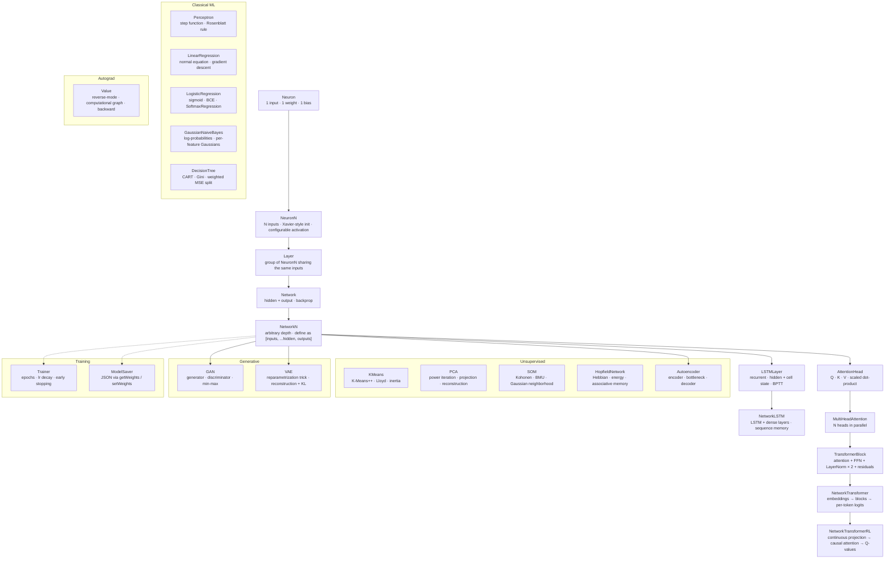

# @dniskav/neuron

[](https://www.npmjs.com/package/@dniskav/neuron)
[](LICENSE)

A minimal, dependency-free neural network library built from scratch in TypeScript. Designed for learning and experimentation — every line of math is readable.

Each class is a building block for the next: from a single neuron to a full Transformer with causal attention. Includes classical ML, unsupervised learning, generative models, embeddings, convolutional and recurrent layers, and autograd — all in pure TypeScript, zero dependencies.



## What's inside

### Neural network building blocks

| Export | Description |
|--------|-------------|
| `Neuron` | Single-input neuron. The simplest possible unit: one weight, one bias. |
| `NeuronN` | N-input neuron with Xavier-style initialization (weights in ±√(1/n)) and a configurable activation. |
| `Layer` | A group of `NeuronN` neurons that share the same inputs. |
| `Network` | Two-layer network (one hidden layer + output) with backpropagation. |
| `NetworkN` | Deep network of arbitrary depth. Define your architecture as `[inputs, ...hidden, outputs]`. |
| `NetworkFast` | The same network as `NetworkN` (same options, methods and weight order) on `Float64Array` buffers, with vectorized optimizers and batch training (`trainBatch`). About 10 times faster to train (0.5). |
| `LSTMLayer` | Recurrent layer with persistent hidden and cell state. Learns sequences via BPTT. |
| `NetworkLSTM` | An `LSTMLayer` followed by dense layers. Keeps memory across steps within an episode. |
| `GRULayer` | Gated recurrent unit with reset and update gates and no separate cell state. |
| `NetworkTransformer` | Token-classification Transformer: embeddings → N blocks → per-token logits. |
| `NetworkTransformerRL` | Transformer for RL agents: continuous input projection → causal blocks → Q-values. |
| `TransformerBlock` | One Transformer block: multi-head attention + FFN + two LayerNorms with residual connections. |
| `MultiHeadAttention` | N attention heads in parallel, concatenated and projected back to `d_model`. |
| `AttentionHead` | One scaled dot-product self-attention head (Q / K / V projections + backprop). |

### Layers & components

| Export | Description |
|--------|-------------|
| `Conv1D` | 1D convolution over sequences. Multi-channel input, configurable stride and padding (`'valid'` or `'same'`). |
| `Conv2D` | 2D convolution for images. Kernels `[filters][kH][kW][channels]`, with forward and backward pass. |
| `MaxPool2D` | 2D max pooling. Stores the argmax of each window, so the gradient goes only to that position. |
| `Flatten` | Converts `[H][W][C]` tensors to flat vectors. Bridges convolutional layers to dense layers. |
| `RNN` | Vanilla recurrent network with BPTT. Its comments show where gradients vanish or explode. |
| `Seq2Seq` | Encoder and decoder built on `LSTMLayer`, with the encoder's final state passed to the decoder. Teacher forcing in training. |
| `CausalConv1D` | Causal dilated 1D convolution (left padding, no look-ahead). One building block of a TCN. |
| `TCN` | Temporal Convolutional Network. Stacks causal dilated convolutions for sequences without recurrence. |
| `LayerNorm` | Layer normalization with learnable γ and β per feature. |
| `BatchNorm` | Batch normalization with running mean and variance, used for inference. |
| `Dropout` | Inverted dropout for regularization. Active only during training. |
| `WeightMatrix` | 2D weight matrix with one Adam optimizer per row (a buffer) and optional gradient clipping (`update(dW, lr, clipValue?)`). |
| `BiasVector` | 1D bias vector with one Adam optimizer over the whole vector. |
| `EmbeddingMatrix` | Lookup-table embedding with SGD updates on the rows that were used. |

### Classical ML

| Export | Description |
|--------|-------------|
| `Perceptron` | The historical Rosenblatt perceptron (1957). Step function, linear rule. Shows why XOR cannot be learned. |
| `LinearRegression` | Closed-form normal equation (`fitNormal`) or gradient descent (`fitGD`). Pure array arithmetic. |
| `LogisticRegression` | Sigmoid + binary cross-entropy, no hidden layers. The boundary between classical ML and neural nets. |
| `SoftmaxRegression` | Multinomial logistic regression with a max-subtracted softmax for numerical stability. |
| `GaussianNaiveBayes` | Class scores in log-space from per-feature Gaussian likelihoods. Fitted by statistics, no gradient descent. |
| `DecisionTree` | CART: Gini impurity for classification, weighted MSE for regression. Depth limited by `maxDepth`. |

### Unsupervised learning

| Export | Description |
|--------|-------------|
| `KMeans` | K-Means++ initialization + Lloyd's algorithm. `inertia()` helps choose K with the elbow method. |
| `PCA` | Principal Component Analysis via power iteration + Hotelling deflation. `transform`, `inverseTransform` (approximate) and `explainedVarianceRatio`. |
| `SOM` | Self-Organizing Map (Kohonen). BMU search and Gaussian neighborhood update. |
| `HopfieldNetwork` | Associative memory. Hebbian storage, energy function, asynchronous recall. Capacity ≈ 0.138·N patterns. |
| `Autoencoder` | Encoder, bottleneck and decoder built from two `NetworkN` instances. Learns compressed representations. |

### Generative models

| Export | Description |
|--------|-------------|
| `GAN` | Generator vs discriminator min-max game, trained step by step (`trainStep`). |
| `VAE` | Variational Autoencoder. Reparametrization trick; loss = reconstruction + `klWeight` · KL divergence (`klWeight` defaults to 1). |

### Automatic differentiation

| Export | Description |
|--------|-------------|
| `Value` | Scalar autograd node. Builds a computational graph and propagates gradients with `.backward()`. Same principle as micrograd. |

### Embeddings

| Export | Description |
|--------|-------------|
| `Word2Vec` | Word embeddings via Skip-gram or CBOW, with a full-vocabulary softmax. Cosine `similarity`, `mostSimilar`, and `analogy`. |
| `TSNE` | t-SNE dimensionality reduction. Per-point perplexity binary search, Student-t kernel, KL gradient, early exaggeration. |
| `PositionalEncoding` | Sinusoidal positional encoding (Vaswani et al.). No parameters; `dModel` may be odd. |
| `LearnedPositionalEncoding` | Trainable positional table of `maxSeqLen × dModel`, with a small Xavier-like random initialization. |
| `ContrastiveLearning` | SimCLR-style self-supervised learning. Encoder + projection head, NT-Xent loss, temperature. |
| `Augmenter` | Views for contrastive pairs: Gaussian noise, feature dropout (no rescaling of kept values), `makePair()`. |

### Activations & math

| Export | Description |
|--------|-------------|
| `sigmoid` `relu` `tanh` `linear` `leakyRelu` `elu` | Built-in activations, each with `fn(x)` and `dfn(out)` (derivative computed from the output). |
| `makeLeakyRelu(α)` `makeElu(α)` | Factories for leaky ReLU and ELU with a custom slope α. |
| `matMul` `transpose` `softmax` `softmaxBackward` | Matrix and softmax helpers. `softmaxBackward` is the softmax gradient. |

### Optimizers

| Export | Description |
|--------|-------------|
| `SGD` | Vanilla stochastic gradient descent. Stateless. |
| `Momentum` | Accumulates a velocity vector in the gradient direction. |
| `Adam` | Adaptive moment estimation. Per-parameter first and second moments with bias correction. |
| `ClipOptimizer` | Wraps any optimizer and clips each gradient to `[-clipValue, +clipValue]` before the step. |
| `ClippedOptimizerFactory` | `(innerFactory, clipValue)`: builds clipped optimizers from any optimizer factory. |
| `defaultOptimizer` | Default factory (`() => new SGD()`), used when no optimizer is given. |

### Random numbers and numeric core (0.5)

| Export | Description |
|--------|-------------|
| `random` `setRandom` `getRandom` `seededRandom` `withRandom` | Injectable random generator. `random()` uses `Math.random` unless `setRandom(fn)` installs one; `seededRandom(seed)` is mulberry32; `withRandom` restores the previous generator. |
| `VecSGD` `VecMomentum` `VecAdam` `VecClip` `ScalarArrayOptimizer` `vecFromFactory` | Vectorized optimizers: one `step(params, grads, lr)` over a whole buffer, with the same numbers as one scalar optimizer per element. `vecFromFactory` falls back to `ScalarArrayOptimizer` for custom optimizers. |
| `defaultBackend` `setBackend` `getBackend` `checkBackend` | Row-major `Float64Array` kernels (`matVec`, `matTVec`, `addOuter` and their batch versions) behind a swappable backend. `checkBackend` runs the conformance cases before you plug in your own. |

### Loss functions

| Export | Description |
|--------|-------------|
| `mse` `crossEntropy` | Scalar loss functions for evaluation and logging. |
| `mseDelta` `crossEntropyDelta` `crossEntropyDeltaRaw` | Output-layer delta functions to pass to `trainWithDeltas`. |

### Metrics & evaluation

| Export | Description |
|--------|-------------|
| `confusionMatrix` | Confusion matrix as `number[][]`. |
| `accuracy` | Fraction of correct predictions. |
| `precision` `recall` `f1Score` | Classification metrics. For multiclass problems they are macro averages (the mean of the per-class values). |
| `rocCurve` `auc` | ROC curve points and area under the curve (trapezoidal rule). |
| `mae` `rmse` `r2Score` | Regression metrics. |
| `perplexity` | `exp(mean cross-entropy)` from predicted probabilities. A common metric for language models. |
| `printConfusionMatrix` `classificationReport` | Console-formatted tables: the confusion matrix, and a per-class report with macro averages. |

### Training utilities

| Export | Description |
|--------|-------------|
| `Trainer` | Training loop with epochs, learning-rate decay, L2 weight decay, optional early stopping and classification metrics. Validation data is used only with `earlyStopping`. |
| `EarlyStopping` | Stops training when a monitored value stops improving. Options: `patience`, `minDelta`, `mode` and `restoreBest`. |
| `LRScheduler` | Learning-rate schedules: `stepDecay`, `exponentialDecay`, `plateauDecay` and `cosineAnnealing`. |
| `DataLoader` | Wraps `{ inputs, targets }` data with batching, shuffling and a validation split. `DataLoader.sequences` builds windows over a time series. |
| `DataAugmentation` | Noise, jitter, horizontal flip, normalization, z-score, batch augmentation, shuffle, and a 70/15/15 train/validation/test split. |
| `WeightInspector` | Per-layer weight statistics (mean, std, dead weights) and dead-ReLU counts. |
| `LossPlotter` | Renders a loss curve as ASCII art in the terminal. |
| `ModelSaver` | `toJSON` / `fromJSON` write and read format 1 (weights only, through `getWeights()` / `setWeights()`). `save` / `load` write and read format 2 (class, configuration and weights) and return a new instance; `register` adds your own classes. `saveToFile` / `loadFromFile` take a file function. |

### Tokenizer & datasets

| Export | Description |
|--------|-------------|
| `Tokenizer` | Vocabulary builder with `char`, `word` or `whitespace` modes. `encode`, `encodeBatch`, `decode`, `oneHot`, and JSON snapshots. |
| `DatasetLoader` | Loads CSV (`fromCSV`) or JSON (`fromJSON`) data, one-hot encoding string columns and returning the category maps. |

### Validation helpers

| Export | Description |
|--------|-------------|
| `validateArray(arr, length, method)` | Throws unless `arr` is an array of exactly `length` finite numbers. |
| `validateArrayMinLength(arr, minLength, method)` | Throws unless `arr` is an array with at least `minLength` elements. |
| `validate2DArray(arr, rows, cols, method)` | Throws unless `arr` is a `rows × cols` matrix of finite numbers. |
| `validateNumber(value, method)` | Throws unless `value` is a finite number. |

### Types

| Export | Description |
|--------|-------------|
| `Activation` | Interface of an activation function: `fn(x)` and `dfn(out)`. |
| `Optimizer` | Interface implemented by `SGD`, `Momentum`, `Adam` and `ClipOptimizer`. |
| `OptimizerFactory` | `() => Optimizer`. The library calls it to build the optimizers of a model. The built-in optimizers become vectorized buffers; a custom factory gets one instance per weight. |
| `NetworkNOptions` | Options for `NetworkN` (activations per layer, optimizer factory, residual connections). |
| `NetworkLSTMOptions` | Options for `NetworkLSTM`. |
| `NetworkTransformerOptions` | Options for `NetworkTransformer`. |
| `NetworkTransformerRLOptions` | Options for `NetworkTransformerRL`. |
| `TransformerBlockOptions` | Options for `TransformerBlock`. |
| `TrainerOptions` | Options for `Trainer`: `epochs`, `lr`, `lrDecay`, `weightDecay`, `earlyStopping`, `restoreBestWeights`, `computeMetrics`, `verbose`. |
| `TrainDataset` | `{ inputs, targets }` arrays given to `Trainer.train`. |
| `TrainableNetwork` | Any object with `train(inputs, targets, lr)` that returns a loss. |
| `TrainableNetworkWithWeights` | `TrainableNetwork` that also has `predict`, `getWeights` and `setWeights` (needed for early stopping with restored weights). |
| `TrainMetrics` | Per-epoch classification metrics: accuracy, and macro precision, recall and F1. |
| `DataPair` | `{ inputs, targets }` pair used by `DataLoader` and `Trainer.setValidationData`. |
| `DatasetLoaderOptions` | Options for `DatasetLoader`: `featureCols`, `targetCols`, `encodeStrings`. |
| `DatasetLoaderResult` | Result of `DatasetLoader`: the data plus the feature and target names and the category maps. |
| `CategoricalMap` | Maps each one-hot encoded column to its `{ category → index }` dictionary. |
| `Serializable` | Interface for `ModelSaver`: `getWeights()` and `setWeights(weights)`. |
| `Saveable` `Registrable` `SaveOptions` | Format 2 types: a model with `kind` and `toConfig()`, a class with a static `fromConfig`, and the options of `ModelSaver.save`. |
| `NetworkNConfig` `ActivationSpec` `OptimizerSpec` `SavedModel` | Format 2 types: the configuration of `NetworkN`, how activations and optimizers are named in the file, and the parsed file. |
| `NetworkFastOptions` | Options for `NetworkFast`: those of `NetworkN` plus `backend`. |
| `VecOptimizer` `RandomFn` `Backend` `BackendReport` | The vectorized optimizer interface, a random generator, the kernels of a backend, and the result of `checkBackend`. |
| `KMeansOptions` | Options for `KMeans`: `maxIter` and `seed`. |
| `SOMOptions` | Options for `SOM`: `initialLr`, `finalLr`, `initialSigma`, `finalSigma`. |
| `Word2VecOptions` | Options for `Word2Vec`: `windowSize`, `model`, `minCount`. |
| `Word2VecModel` | `'skipgram' \| 'cbow'`. |
| `TSNEOptions` | Options for `TSNE`, among them `nComponents`, `perplexity` and `lr`. |
| `WeightStats` | Statistics for one layer, as returned by `WeightInspector`. |
| `TokenizerMode` | `'char' \| 'word' \| 'whitespace'`. |
| `TokenizerOptions` | Options for `Tokenizer` (mode, `lowercase`, `maxVocab`, special tokens). |
| `EncodeOptions` | `addBOS` and `addEOS` for `Tokenizer.encode`. |
| `EncodeBatchOptions` | `EncodeOptions` for `Tokenizer.encodeBatch`, plus `padTo` (pad or truncate every sequence to one length). |
| `TokenizerSnapshot` | JSON snapshot of a `Tokenizer` (from `toJSON`, read by `fromJSON`). |

## Install

```bash
npm install @dniskav/neuron
```

Requires Node.js 20 or later (`engines` in `package.json`). The package ships CommonJS and ES module builds, with TypeScript declarations.
## Quick start

Build a network, train it one sample at a time, then predict. This example learns XOR, which a single neuron cannot represent.

```ts
import { NetworkN, Adam, relu, sigmoid, seededRandom, setRandom } from "@dniskav/neuron";

setRandom(seededRandom(7)); // optional: reproducible initial weights
const net = new NetworkN([2, 8, 1], { activations: [relu, sigmoid], optimizer: () => new Adam() });
setRandom(null);            // back to Math.random

const inputs = [[0, 0], [0, 1], [1, 0], [1, 1]];
const targets = [[0], [1], [1], [0]];
for (let epoch = 0; epoch < 2000; epoch++)
  inputs.forEach((x, i) => net.train(x, targets[i], 0.01));

const out = inputs.map((x) => net.predict(x)[0]);
console.log(out.map((p) => p.toFixed(2)));
if (!(out[0] < 0.5 && out[1] > 0.5 && out[2] > 0.5 && out[3] < 0.5)) throw new Error(`XOR not learned: ${out}`);
```

Every model follows the same pattern: construct it, call `train` (or `trainBatch` in `NetworkFast`), then `predict`. The guides below cover each class with examples that are run and checked.
## What's new in 0.5

0.5 is additive: your code and your saved weights keep working. The full list is in [CHANGELOG.md](CHANGELOG.md), and the long examples are in [docs/fast-core.md](https://github.com/dniskav/neuron/blob/master/docs/fast-core.md).

- **`NetworkFast`** has the same constructor, options, methods and weight order as `NetworkN`, on `Float64Array` buffers with the vectorized optimizers (`VecSGD`, `VecMomentum`, `VecAdam`, `VecClip`, the `VecOptimizer` interface, `vecFromFactory`, `ScalarArrayOptimizer`). With the same seed it reaches the same weights, and it trains about 10 times faster. `NetworkFastOptions` adds `backend`.
- **Batches.** `NetworkFast.trainBatch(X, T, lr)` takes one step with the mean gradient of the batch and returns the mean squared error; `predictBatch(X)` predicts a list. `Trainer` takes `batchSize`.
- **Seeds.** `setRandom(seededRandom(seed))` makes construction and training reproducible. `getRandom`, `withRandom`, `random` and the type `RandomFn` complete the API.
- **Format 2.** `ModelSaver.save(model)` writes the class, its configuration and the weights, and `ModelSaver.load(json)` returns a new instance ready to predict and to train. `ModelSaver.register` adds your own classes (types `Saveable`, `Registrable`, `SaveOptions`, `NetworkNConfig`, `ActivationSpec`, `OptimizerSpec`, `SavedModel`).
- **Inference.** The `@dniskav/neuron/infer` entry exports `loadForInference`, which reads format 2 of dense models and only predicts: no optimizers, backpropagation, `Trainer` or random generator. `@dniskav/neuron/infer/min` is a minified ESM build of about 7 KB, for pages without a bundler.
- **Backend.** The numeric kernels (`matVec`, `matTVec`, `addOuter` and their batch versions) sit behind `setBackend`, `getBackend`, `defaultBackend` and `checkBackend`, with the types `Backend` and `BackendReport`. Check your implementation with `checkBackend` before you plug it in.
- **Your own embeddings.** `NetworkTransformer.setTokenEmbeddings(rows, { freeze })` loads vectors computed elsewhere, and `freezeEmbeddings` does the same at construction.

### Same network, faster engine

`NetworkFast` and `NetworkN` built with the same seed train to the same weights.

```ts
import { NetworkN, NetworkFast, Adam, relu, sigmoid, setRandom, seededRandom } from "@dniskav/neuron";

const options = { activations: [relu, sigmoid], optimizer: () => new Adam() };
setRandom(seededRandom(1));
const slow = new NetworkN([2, 8, 1], options);
setRandom(seededRandom(1));
const fast = new NetworkFast([2, 8, 1], options);
setRandom(null);

const X = [[0, 0], [0, 1], [1, 0], [1, 1]];
const T = [[0], [1], [1], [0]];
for (let epoch = 0; epoch < 200; epoch++)
  X.forEach((x, i) => { slow.train(x, T[i], 0.05); fast.train(x, T[i], 0.05); });

const a = slow.getWeights();
const b = fast.getWeights();
const maxDiff = Math.max(...a.map((w, i) => Math.abs(w - b[i])));
const batchLoss = fast.trainBatch(X, T, 0.05); // a batch is one step with the mean gradient
console.log(maxDiff < 1e-12, fast.predictBatch(X).length, batchLoss.toFixed(4));
if (!(maxDiff < 1e-12) || fast.predictBatch(X).length !== 4) throw new Error(`NetworkFast drifted: ${maxDiff}`);
```

### Save a model and predict without the training code

`ModelSaver.save` writes format 2, which keeps the class and its configuration, so `loadForInference` can rebuild a dense model that only predicts.

```ts
import { NetworkN, ModelSaver } from "@dniskav/neuron";
import { loadForInference } from "@dniskav/neuron/infer";

const net = new NetworkN([2, 4, 1]);
const model = loadForInference(ModelSaver.save(net));
const x = [0.3, 0.7];
console.log(model.kind, model.predict(x)[0] === net.predict(x)[0], model.predictBatch([x, [1, 0]]).length);
if (model.kind !== "NetworkN" || model.predict(x)[0] !== net.predict(x)[0]) throw new Error("infer and the model disagree");
```

### Your own embeddings in NetworkTransformer

`setTokenEmbeddings` checks that there is one row per token, `d_model` values per row, all finite, before it writes anything. With `freeze: true`, training leaves the table unchanged.

```ts
import { NetworkTransformer } from "@dniskav/neuron";

const net = new NetworkTransformer(3, { vocabSize: 4, d_model: 8, nHeads: 2, nClasses: 2 });
const mine = Array.from({ length: 4 }, (_, i) => Array.from({ length: 8 }, (_, j) => Math.sin(i + j)));
net.setTokenEmbeddings(mine, { freeze: true });

const before = net.tokenEmb.getWeights();
for (let i = 0; i < 20; i++) net.train([1, 2, 3], [0, 1, 0], 0.01);
const same = net.tokenEmb.getWeights().every((w, k) => w === before[k]);
console.log(same); // true
if (!same) throw new Error("the frozen embeddings changed");
```
## Extending the library

Every extension point is a small interface. The library calls the methods it needs and does not check which class you pass in.

| Contract | What you provide | Used by |
|---|---|---|
| `Activation` | `fn(x)` and `dfn(out)`; `dfn` takes the output of `fn`. Optional `name` and `alpha`, which saving needs for built-ins. | `NeuronN`, `NetworkN`, `NetworkFast` |
| `Optimizer` and `OptimizerFactory` | `step(weight, gradient, lr)` returns the new weight. The gradient is the ascent direction, so return `weight + lr * gradient`. The factory makes one instance per weight. | `NeuronN`, `NetworkN`, `NetworkFast`, the layers |
| `trainWithDeltas` and `inputGradient` | Output deltas that already include the activation derivative. Use them when the loss is computed outside the library. | `NetworkN`, `NetworkFast`; `GAN` and `VAE` use them internally |
| `TrainableNetwork` | `train(inputs, targets, lr)` returns the loss. Optional `trainBatch(X, T, lr)` for `batchSize` above 1. | `Trainer` |
| `Serializable` and `Saveable` | `getWeights()` and `setWeights()`. For format 2 also `kind` and `toConfig()`, which returns plain JSON data. | `ModelSaver` |
| `Registrable` | A static `fromConfig(config)` that rebuilds the model. Add it with `ModelSaver.register(kind, Class)`. | `ModelSaver.load` |
| `RandomFn` | A function that returns a number in [0, 1). Install it with `setRandom`. | every random draw |
| `Backend` | The kernels you replace with `setBackend`. Check them with `checkBackend` first. | `NetworkFast`, `loadForInference` |

### A custom activation

A custom activation trains like a built-in one. The `dfn` of this example takes the output: for softplus, `ln(1 + e^x)`, the derivative is `1 - e^(-y)`.

```ts
import { NetworkN, sigmoid, setRandom, seededRandom } from "@dniskav/neuron";

const softplus = {
  fn: (x: number) => Math.log(1 + Math.exp(x)),
  dfn: (out: number) => 1 - Math.exp(-out),
};

setRandom(seededRandom(3));
const net = new NetworkN([2, 6, 1], { activations: [softplus, sigmoid] });
setRandom(null);

const data: [number[], number[]][] = [[[0, 0], [0]], [[0, 1], [0.5]], [[1, 0], [0.5]], [[1, 1], [1]]];
const loss = () => data.reduce((s, [x, t]) => s + (net.predict(x)[0] - t[0]) ** 2, 0) / data.length;
const before = loss();
for (let epoch = 0; epoch < 300; epoch++)
  for (const [x, t] of data) net.train(x, t, 0.5);
const after = loss();
console.log(after < before / 2); // true
if (!(after < before / 2)) throw new Error(`the softplus network did not learn: ${before} -> ${after}`);
```

A custom optimizer and a custom model saved in format 2 (with `ModelSaver.register`) are in the [extending section of docs/fast-core.md](https://github.com/dniskav/neuron/blob/master/docs/fast-core.md#extending-the-library).
## Guides

The long examples are in `docs/`, one guide per topic. Every example there is run by the same gate as the examples in this README, and each one ends with a check that throws if the result is wrong. The links are absolute because the `docs/` folder is not in the npm package.

- [Basic usage](https://github.com/dniskav/neuron/blob/master/docs/basics.md): a single neuron, `NetworkN` with Adam, the Perceptron, linear and logistic regression, Gaussian Naive Bayes, decision trees, K-Means, PCA, SOM and the Hopfield network (11 examples).
- [Models](https://github.com/dniskav/neuron/blob/master/docs/models.md): Autoencoder, GAN, VAE, Word2Vec, t-SNE, positional encodings and contrastive learning (7 examples).
- [Sequences](https://github.com/dniskav/neuron/blob/master/docs/sequences.md): the `Value` autograd, Conv2D with MaxPool2D and Flatten, Conv1D, RNN, TCN and NetworkLSTM (6 examples).
- [Training and evaluation tools](https://github.com/dniskav/neuron/blob/master/docs/tools.md): metrics, early stopping, `Trainer`, `ClippedOptimizerFactory`, `ModelSaver`, `DataLoader`, `Tokenizer`, `DatasetLoader`, `DataAugmentation`, `WeightInspector` and `LossPlotter` (12 examples).
- [Fast core and extending the library](https://github.com/dniskav/neuron/blob/master/docs/fast-core.md): seeds with `setRandom`, the vectorized optimizers, `setBackend` and `checkBackend`, `NetworkFast` and batches, format 2 with `ModelSaver.save` and `load`, `infer`, your own embeddings, and custom activations, optimizers and models (12 examples).
## How it works

The neural classes, from `Neuron` to `NetworkN`, apply an **activation function** to the weighted sum of their inputs and use **gradient descent** to adjust the weights. For one sigmoid output neuron with plain SGD, the update is:

```text
delta   = (target − output) × activation′(sum)
weight += lr × delta × input
bias   += lr × delta
```

This is the rule in `Neuron.train` (`src/Neuron.ts`) and `NeuronN.train` (`src/NeuronN.ts`). The update adds `lr × delta × input`, because the step follows the negative gradient of the squared error.

`NetworkN` implements full **backpropagation** across all layers: deltas flow from the output back to the first layer with the chain rule (`_backward`, `src/NetworkN.ts`). Its `train` starts from the gradient of the **mean** squared error that it returns: `(2 / n) × (target − output)` for each of the `n` outputs (`src/NetworkN.ts`; the returned loss is computed in the same method). So `lr` is the step size of that loss, whatever the number of outputs. `Network.train` uses the same factor (`src/Network.ts`). This changed in 0.4.0, see [Upgrading to 0.4](#upgrading-to-04).

`NeuronN` uses a **simplified Xavier initialization**: each weight is drawn uniformly from `[-√(1/n), +√(1/n)]`, where `n` is the number of inputs, and the bias starts at 0 (`src/NeuronN.ts`). `NetworkN` builds its layers from `NeuronN` (`src/Layer.ts`), so it starts the same way.

When an **optimizer** is used (e.g., Adam), the raw gradient is passed to the optimizer instead of being applied directly. `SGD` applies `w ← w + lr·g` (`src/optimizers.ts`); other optimizers take different steps. The built-in optimizers keep their state in buffers, one per neuron or matrix (`src/core/optim.ts`); a custom optimizer still gets one instance per weight.

The `Value` class implements **reverse-mode automatic differentiation**: every operation records its inputs and a `_backward` closure. Calling `.backward()` on the output node builds a topological order and propagates `∂L/∂w` through the graph (`src/Tape.ts`).

## Known limitations

- **`ContrastiveLearning`:** the raw initialization can leave a projection head dead, with a zero-norm output (`src/ContrastiveLearning.ts`). On small problems the loss may not go down.
- **`VAE`:** with the default `klWeight` of 1, the model collapses on small datasets and the latent code stops carrying information. In the measured case a `klWeight` around 0.003 learned (`src/VAE.ts`).
- **`PCA`:** with rank-deficient data, the axes with zero variance can have a norm close to 0, so they are not an orthonormal basis. Do not use them as one.
- **`TSNE`:** with a small number of points, the default `lr` of 200 diverges. The stable range depends on the number of points (`src/TSNE.ts`).
- **`TCN`:** sensitive to `lr`. The header of `src/TCN.ts` lists the measured range.
- **Randomness:** every random draw goes through `random()`, which uses `Math.random` unless you install a generator: `setRandom(seededRandom(seed))` makes the whole library reproducible (`KMeans` and `TSNE` also take their own `seed`). The examples in this README fix `Math.random` in their own block.
- **Training:** most models train online (one sample, sequence or episode per update). `NetworkFast` also trains on batches (`trainBatch`). Everything runs on the CPU in plain JavaScript; there is no GPU backend.

See [CHANGELOG.md](CHANGELOG.md) for the full list.

## Upgrading to 0.4

0.4.0 changes how several models train, so 0.3.2 results are not directly comparable:

- Weights and learning rates tuned with 0.3.2 are not a good starting point. Retrain, and re-tune `lr`.
- `NetworkN.train` with `n` outputs, and `Network.train` with one output: `lr_new = lr_old × n / 2` reproduces the old step with the default optimizer or `Momentum` (with `Adam`, keep `lr`). `Network.train` with several outputs and `NetworkN` with `residual` have no recipe, so retrain.
- Many methods now throw on invalid input (empty data, wrong lengths, `NaN`, invalid options) instead of failing silently.
- `Trainer` rejects `lr = 0`, and the `clipValue` option is gone: use `ClippedOptimizerFactory`.

The full guide, with the breaking changes and their migration steps, is in [CHANGELOG.md](CHANGELOG.md).

## Upgrading to 0.5

0.5 is additive: your code and your saved weights keep working. Two observable changes:

- `NeuronN.weights` is updated in place. If you kept a reference to that array, it now sees the new values.
- The built-in activations have a `name` (and an `alpha` for `leakyRelu` and `elu`). A test that compares an activation with `toEqual` against a literal `{ fn, dfn }` no longer passes.

The full list, with the new features and the performance figures, is in [CHANGELOG.md](CHANGELOG.md).

## Build

```bash
npm run build      # tsup: CJS, ESM and type declarations into dist/ (cleans dist/ first)
npm run dev        # the same build in watch mode
npm test           # vitest run (one pass)
npm run test:watch # vitest in watch mode
npm run coverage   # vitest run with v8 coverage
npm run typecheck  # tsc --noEmit over src/ and tests/
```

The build writes `dist/index.js` (CommonJS), `dist/index.mjs` (ES modules), and `dist/index.d.ts` and `dist/index.d.mts` (types).

## For AI agents

If you are an AI agent or LLM working with this codebase, read [AGENTS.md](AGENTS.md) first. It is the entry point for agents working on this repository.

## Roadmap (nice to have)

These features are intentionally out of scope for the current didactic focus but are documented here for reference.

### ONNX export

Export trained models to the [ONNX](https://onnx.ai/) interchange format so they can be run in Python (onnxruntime), browsers (onnxruntime-web), mobile, or production inference servers.

**What it would require:**
- Serialize each layer's weights + op type to the protobuf ONNX schema (`onnx.proto`).
- Map neuron layer types to standard ONNX operators (`Gemm`, `MatMul`, `LSTM`, `Conv`, `Relu`, `Softmax`, …).
- Handle dynamic batch dimensions in the graph IR.
- Ship a build step that compiles the `.proto` definitions (adds a dev dependency on `protobufjs` or `onnx-proto`).

**Why it's skipped:** It adds a non-trivial build pipeline and a dependency. The library has zero runtime dependencies by design. ONNX export makes sense once you outgrow the library for training — at that point PyTorch/TF are the right tools.

### WebGL / WASM backend

Replace the current pure-JS number arrays with a GPU-accelerated or WASM-compiled backend so larger models (e.g. ViT, GPT-2 scale) become feasible in the browser. Since 0.5 the numeric kernels sit behind `setBackend` (see "Extending the library"), so such a backend has a place to plug in; the package does not ship one.

**What it would require:**
- Abstract `Tensor` type that backends implement (JS arrays, WebGL textures, WASM memory).
- WebGL backend: encode matrix ops as fragment-shader programs (similar to `gpu.js` or `tfjs-backend-webgl`).
- WASM backend: compile a BLAS-like C/Rust core (e.g. `wasm-bindgen` + `ndarray`) and bind it to TypeScript.
- Every layer's `forward` / `backward` rewritten against the `Tensor` API.

**Why it's skipped:** The goal is to make the math readable. GPU shader code and WASM bindings are implementation details that obscure the algorithms. The library intentionally trades performance for pedagogical clarity.

## Changelog

Release notes for every version, including the 0.4.0 breaking changes, the migration guide and the known limitations, are in [CHANGELOG.md](CHANGELOG.md).

## License

MIT. See [LICENSE](LICENSE).
