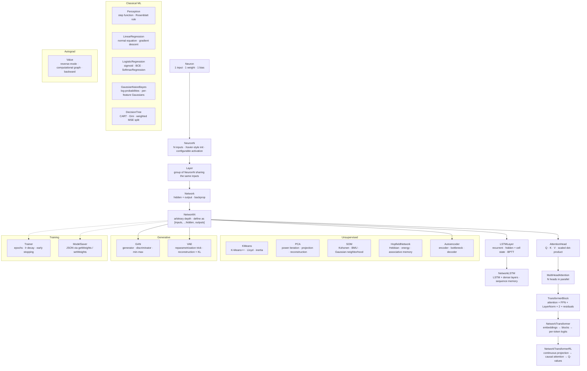

# @dniskav/neuron

[](https://www.npmjs.com/package/@dniskav/neuron)
[](LICENSE)

A minimal, dependency-free neural network library built from scratch in TypeScript. Designed for learning and experimentation — every line of math is readable.

Each class is a building block for the next: from a single neuron to a full Transformer with causal attention. Includes classical ML, unsupervised learning, generative models, embeddings, convolutional and recurrent layers, and autograd — all in pure TypeScript, zero dependencies.



## What's inside

### Neural network building blocks

| Export | Description |
|--------|-------------|
| `Neuron` | Single-input neuron. The simplest possible unit: one weight, one bias. |
| `NeuronN` | N-input neuron with Xavier-style initialization (weights in ±√(1/n)) and a configurable activation. |
| `Layer` | A group of `NeuronN` neurons that share the same inputs. |
| `Network` | Two-layer network (one hidden layer + output) with backpropagation. |
| `NetworkN` | Deep network of arbitrary depth. Define your architecture as `[inputs, ...hidden, outputs]`. |
| `LSTMLayer` | Recurrent layer with persistent hidden and cell state. Learns sequences via BPTT. |
| `NetworkLSTM` | An `LSTMLayer` followed by dense layers. Keeps memory across steps within an episode. |
| `GRULayer` | Gated recurrent unit with reset and update gates and no separate cell state. |
| `NetworkTransformer` | Token-classification Transformer: embeddings → N blocks → per-token logits. |
| `NetworkTransformerRL` | Transformer for RL agents: continuous input projection → causal blocks → Q-values. |
| `TransformerBlock` | One Transformer block: multi-head attention + FFN + two LayerNorms with residual connections. |
| `MultiHeadAttention` | N attention heads in parallel, concatenated and projected back to `d_model`. |
| `AttentionHead` | One scaled dot-product self-attention head (Q / K / V projections + backprop). |

### Layers & components

| Export | Description |
|--------|-------------|
| `Conv1D` | 1D convolution over sequences. Multi-channel input, configurable stride and padding (`'valid'` or `'same'`). |
| `Conv2D` | 2D convolution for images. Kernels `[filters][kH][kW][channels]`, with forward and backward pass. |
| `MaxPool2D` | 2D max pooling. Stores the argmax of each window, so the gradient goes only to that position. |
| `Flatten` | Converts `[H][W][C]` tensors to flat vectors. Bridges convolutional layers to dense layers. |
| `RNN` | Vanilla recurrent network with BPTT. Its comments show where gradients vanish or explode. |
| `Seq2Seq` | Encoder and decoder built on `LSTMLayer`, with the encoder's final state passed to the decoder. Teacher forcing in training. |
| `CausalConv1D` | Causal dilated 1D convolution (left padding, no look-ahead). One building block of a TCN. |
| `TCN` | Temporal Convolutional Network. Stacks causal dilated convolutions for sequences without recurrence. |
| `LayerNorm` | Layer normalization with learnable γ and β per feature. |
| `BatchNorm` | Batch normalization with running mean and variance, used for inference. |
| `Dropout` | Inverted dropout for regularization. Active only during training. |
| `WeightMatrix` | 2D weight matrix with per-element Adam state and optional gradient clipping (`update(dW, lr, clipValue?)`). |
| `BiasVector` | 1D bias vector with per-element Adam state. |
| `EmbeddingMatrix` | Lookup-table embedding with SGD updates on the rows that were used. |

### Classical ML

| Export | Description |
|--------|-------------|
| `Perceptron` | The historical Rosenblatt perceptron (1957). Step function, linear rule. Shows why XOR cannot be learned. |
| `LinearRegression` | Closed-form normal equation (`fitNormal`) or gradient descent (`fitGD`). Pure array arithmetic. |
| `LogisticRegression` | Sigmoid + binary cross-entropy, no hidden layers. The boundary between classical ML and neural nets. |
| `SoftmaxRegression` | Multinomial logistic regression with a max-subtracted softmax for numerical stability. |
| `GaussianNaiveBayes` | Class scores in log-space from per-feature Gaussian likelihoods. Fitted by statistics, no gradient descent. |
| `DecisionTree` | CART: Gini impurity for classification, weighted MSE for regression. Depth limited by `maxDepth`. |

### Unsupervised learning

| Export | Description |
|--------|-------------|
| `KMeans` | K-Means++ initialization + Lloyd's algorithm. `inertia()` helps choose K with the elbow method. |
| `PCA` | Principal Component Analysis via power iteration + Hotelling deflation. `transform`, `inverseTransform` (approximate) and `explainedVarianceRatio`. |
| `SOM` | Self-Organizing Map (Kohonen). BMU search and Gaussian neighborhood update. |
| `HopfieldNetwork` | Associative memory. Hebbian storage, energy function, asynchronous recall. Capacity ≈ 0.138·N patterns. |
| `Autoencoder` | Encoder, bottleneck and decoder built from two `NetworkN` instances. Learns compressed representations. |

### Generative models

| Export | Description |
|--------|-------------|
| `GAN` | Generator vs discriminator min-max game, trained step by step (`trainStep`). |
| `VAE` | Variational Autoencoder. Reparametrization trick; loss = reconstruction + `klWeight` · KL divergence (`klWeight` defaults to 1). |

### Automatic differentiation

| Export | Description |
|--------|-------------|
| `Value` | Scalar autograd node. Builds a computational graph and propagates gradients with `.backward()`. Same principle as micrograd. |

### Embeddings

| Export | Description |
|--------|-------------|
| `Word2Vec` | Word embeddings via Skip-gram or CBOW, with a full-vocabulary softmax. Cosine `similarity`, `mostSimilar`, and `analogy`. |
| `TSNE` | t-SNE dimensionality reduction. Per-point perplexity binary search, Student-t kernel, KL gradient, early exaggeration. |
| `PositionalEncoding` | Sinusoidal positional encoding (Vaswani et al.). No parameters; `dModel` may be odd. |
| `LearnedPositionalEncoding` | Trainable positional table of `maxSeqLen × dModel`, with a small Xavier-like random initialization. |
| `ContrastiveLearning` | SimCLR-style self-supervised learning. Encoder + projection head, NT-Xent loss, temperature. |
| `Augmenter` | Views for contrastive pairs: Gaussian noise, feature dropout (no rescaling of kept values), `makePair()`. |

### Activations & math

| Export | Description |
|--------|-------------|
| `sigmoid` `relu` `tanh` `linear` `leakyRelu` `elu` | Built-in activations, each with `fn(x)` and `dfn(out)` (derivative computed from the output). |
| `makeLeakyRelu(α)` `makeElu(α)` | Factories for leaky ReLU and ELU with a custom slope α. |
| `matMul` `transpose` `softmax` `softmaxBackward` | Matrix and softmax helpers. `softmaxBackward` is the softmax gradient. |

### Optimizers

| Export | Description |
|--------|-------------|
| `SGD` | Vanilla stochastic gradient descent. Stateless. |
| `Momentum` | Accumulates a velocity vector in the gradient direction. |
| `Adam` | Adaptive moment estimation. Per-parameter first and second moments with bias correction. |
| `ClipOptimizer` | Wraps any optimizer and clips each gradient to `[-clipValue, +clipValue]` before the step. |
| `ClippedOptimizerFactory` | `(innerFactory, clipValue)`: builds clipped optimizers from any optimizer factory. |
| `defaultOptimizer` | Default factory (`() => new SGD()`), used when no optimizer is given. |

### Loss functions

| Export | Description |
|--------|-------------|
| `mse` `crossEntropy` | Scalar loss functions for evaluation and logging. |
| `mseDelta` `crossEntropyDelta` `crossEntropyDeltaRaw` | Output-layer delta functions to pass to `trainWithDeltas`. |

### Metrics & evaluation

| Export | Description |
|--------|-------------|
| `confusionMatrix` | Confusion matrix as `number[][]`. |
| `accuracy` | Fraction of correct predictions. |
| `precision` `recall` `f1Score` | Classification metrics. For multiclass problems they are macro averages (the mean of the per-class values). |
| `rocCurve` `auc` | ROC curve points and area under the curve (trapezoidal rule). |
| `mae` `rmse` `r2Score` | Regression metrics. |
| `perplexity` | `exp(mean cross-entropy)` from predicted probabilities. A common metric for language models. |
| `printConfusionMatrix` `classificationReport` | Console-formatted tables: the confusion matrix, and a per-class report with macro averages. |

### Training utilities

| Export | Description |
|--------|-------------|
| `Trainer` | Training loop with epochs, learning-rate decay, L2 weight decay, optional early stopping and classification metrics. Validation data is used only with `earlyStopping`. |
| `EarlyStopping` | Stops training when a monitored value stops improving. Options: `patience`, `minDelta`, `mode` and `restoreBest`. |
| `LRScheduler` | Learning-rate schedules: `stepDecay`, `exponentialDecay`, `plateauDecay` and `cosineAnnealing`. |
| `DataLoader` | Wraps `{ inputs, targets }` data with batching, shuffling and a validation split. `DataLoader.sequences` builds windows over a time series. |
| `DataAugmentation` | Noise, jitter, horizontal flip, normalization, z-score, batch augmentation, shuffle, and a 70/15/15 train/validation/test split. |
| `WeightInspector` | Per-layer weight statistics (mean, std, dead weights) and dead-ReLU counts. |
| `LossPlotter` | Renders a loss curve as ASCII art in the terminal. |
| `ModelSaver` | Serialization through the flat `getWeights()` / `setWeights()` interface. JSON with `format: 1`, plus `saveToFile` / `loadFromFile` helpers that take a file function. |

### Tokenizer & datasets

| Export | Description |
|--------|-------------|
| `Tokenizer` | Vocabulary builder with `char`, `word` or `whitespace` modes. `encode`, `encodeBatch`, `decode`, `oneHot`, and JSON snapshots. |
| `DatasetLoader` | Loads CSV (`fromCSV`) or JSON (`fromJSON`) data, one-hot encoding string columns and returning the category maps. |

### Validation helpers

| Export | Description |
|--------|-------------|
| `validateArray(arr, length, method)` | Throws unless `arr` is an array of exactly `length` finite numbers. |
| `validateArrayMinLength(arr, minLength, method)` | Throws unless `arr` is an array with at least `minLength` elements. |
| `validate2DArray(arr, rows, cols, method)` | Throws unless `arr` is a `rows × cols` matrix of finite numbers. |
| `validateNumber(value, method)` | Throws unless `value` is a finite number. |

### Types

| Export | Description |
|--------|-------------|
| `Activation` | Interface of an activation function: `fn(x)` and `dfn(out)`. |
| `Optimizer` | Interface implemented by `SGD`, `Momentum`, `Adam` and `ClipOptimizer`. |
| `OptimizerFactory` | `() => Optimizer`. A network creates one optimizer per weight. |
| `NetworkNOptions` | Options for `NetworkN` (activations per layer, optimizer factory, residual connections). |
| `NetworkLSTMOptions` | Options for `NetworkLSTM`. |
| `NetworkTransformerOptions` | Options for `NetworkTransformer`. |
| `NetworkTransformerRLOptions` | Options for `NetworkTransformerRL`. |
| `TransformerBlockOptions` | Options for `TransformerBlock`. |
| `TrainerOptions` | Options for `Trainer`: `epochs`, `lr`, `lrDecay`, `weightDecay`, `earlyStopping`, `restoreBestWeights`, `computeMetrics`, `verbose`. |
| `TrainDataset` | `{ inputs, targets }` arrays given to `Trainer.train`. |
| `TrainableNetwork` | Any object with `train(inputs, targets, lr)` that returns a loss. |
| `TrainableNetworkWithWeights` | `TrainableNetwork` that also has `predict`, `getWeights` and `setWeights` (needed for early stopping with restored weights). |
| `TrainMetrics` | Per-epoch classification metrics: accuracy, and macro precision, recall and F1. |
| `DataPair` | `{ inputs, targets }` pair used by `DataLoader` and `Trainer.setValidationData`. |
| `DatasetLoaderOptions` | Options for `DatasetLoader`: `featureCols`, `targetCols`, `encodeStrings`. |
| `DatasetLoaderResult` | Result of `DatasetLoader`: the data plus the feature and target names and the category maps. |
| `CategoricalMap` | Maps each one-hot encoded column to its `{ category → index }` dictionary. |
| `Serializable` | Interface for `ModelSaver`: `getWeights()` and `setWeights(weights)`. |
| `KMeansOptions` | Options for `KMeans`: `maxIter` and `seed`. |
| `SOMOptions` | Options for `SOM`: `initialLr`, `finalLr`, `initialSigma`, `finalSigma`. |
| `Word2VecOptions` | Options for `Word2Vec`: `windowSize`, `model`, `minCount`. |
| `Word2VecModel` | `'skipgram' \| 'cbow'`. |
| `TSNEOptions` | Options for `TSNE`, among them `nComponents`, `perplexity` and `lr`. |
| `WeightStats` | Statistics for one layer, as returned by `WeightInspector`. |
| `TokenizerMode` | `'char' \| 'word' \| 'whitespace'`. |
| `TokenizerOptions` | Options for `Tokenizer` (mode, `lowercase`, `maxVocab`, special tokens). |
| `EncodeOptions` | `addBOS` and `addEOS` for `Tokenizer.encode`. |
| `EncodeBatchOptions` | `EncodeOptions` for `Tokenizer.encodeBatch`, plus `padTo` (pad or truncate every sequence to one length). |
| `TokenizerSnapshot` | JSON snapshot of a `Tokenizer` (from `toJSON`, read by `fromJSON`). |

## Install

```bash
npm install @dniskav/neuron
```

Requires Node.js 20 or later (`engines` in `package.json`). The package ships CommonJS and ES module builds, with TypeScript declarations.
